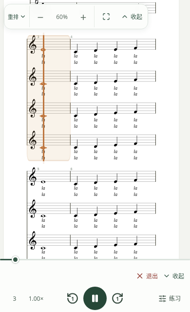
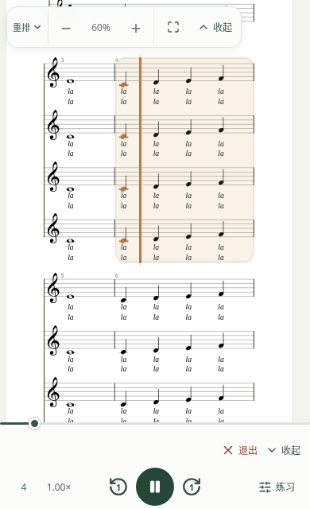

# MusicXML 换行跟随验收

最终产品 head：`dfc687c1dc09fedc80cacdae6758f20ad23638ae`，基于 main `91eada0`。本分支只有合成谱、真实浏览器证据及独立验收脚本，不被应用构建消费。

相邻线性系统需要移动时，全部位移只发生在下一系统第一拍前约 120ms 的窗口。按实际展开 MIDI 位置、当前速度与小节内 tempo changes 计算截止点，并留一帧收尾余量；下一行已完整可读则不移动。新行第一拍到来后不继续动画，同系统后续小节保持稳定；迟到的时钟/绘制通知直接到位。工具栏只提供按视口计算的固定留白，播放器会话统一拥有程序化跟随滚动。

## 真实实录

Playwright recordVideo 原录制裁剪，未用截图制作动画；H.264/yuv420p MP4，无声音。1.00× 约 5.2 秒，1.50× 约 4.2 秒。

- [Chromium 窄屏 390×640，72 BPM / 1.00×](review/chromium-390.mp4)
- [Chromium 宽屏 768×900，72 BPM / 1.00×](review/chromium-768.mp4)
- [Chromium 窄屏 1.50×](review/chromium-390-fast.mp4) · [宽屏 1.50×](review/chromium-768-fast.mp4)
- [WebKit 窄屏](review/webkit-390.mp4) · [WebKit 宽屏](review/webkit-768.mp4)

## 实际时钟与位置

以下时间相对下一行首拍，以 SDK 的真实播放位置通知推算；不是原始音频逐采样测量。脚本没有发出伪造播放位置事件。每行都验证：窗口外不动、位移单调、首个新系统位置通知和首个新系统画面采样均已在终点、同系统第二小节的观测区间无新滚动。

| 浏览器 / 视口 / 倍率 | 首次位移距首拍 | 已停稳距首拍 | 首拍 scrollTop | 同系统第二小节 |
|---|---:|---:|---:|---|
| Chromium 390 / 1.00× | 108.3ms 前 | 28.4ms 前 | 343 | 343 |
| Chromium 390 / 1.50× | 99.0ms 前 | 28.4ms 前 | 343 | 343 |
| Chromium 768 / 1.00× | 108.4ms 前 | 18.7ms 前 | 614 | 614 |
| Chromium 768 / 1.50× | 98.9ms 前 | 27.0ms 前 | 614 | 614 |
| WebKit 390 / 1.00× | 104.3ms 前 | 19.3ms 前 | 343 | 343 |
| WebKit 390 / 1.50× | 104.8ms 前 | 20.8ms 前 | 343 | 343 |
| WebKit 768 / 1.00× | 84.3ms 前 | 19.3ms 前 | 613 | 613 |
| WebKit 768 / 1.50× | 111.8ms 前 | 24.8ms 前 | 613 | 613 |
| Chromium 390 / 180 BPM、2.00×、末音八分音符 | 109.3ms 前 | 28.5ms 前 | 343 | 该系统仅一小节 |
| Chromium 768 / 180 BPM、2.00×、末音八分音符 | 99.1ms 前 | 17.6ms 前 | 614 | 614 |

快速谱的末音约 83ms；120ms 是毫秒窗口，与整拍时长无关。正常样本为同一段 SATB、双行 la 歌词、全音符/四分音符交替；快速样本每小节以短八分音符结束。所有内容均为合成测试谱。

[简洁逐事件/逐帧摘要](review/summary.json)包含对应小节、系统边界、开始/截止、实际位置序列和首拍前后矩形。原始 JSON 压缩保存在 `review/raw`，可用 `gzip -dc` 读取。WebKit 与 Chromium 的亚像素滚动取整不同；各自采用原生 scrollTop，不用截图阈值作为 CI 判断。

Linux WebKit 的宽屏 SVG 绘制帧较疏，可能跨过截止点才产生下一个画面采样；播放位置通知已在首拍前结束滚动，首个新行画面采样为终点。不能据此声称真机每一帧都有相同时间间隔。WebKit 原生游标也按其绘制时序更新，截图不冒称逐采样音频时刻。

## 最终截图

| 新系统首小节（印刷 3） | 同系统第二小节（印刷 4） |
|---|---|
|  |  |

已亲自打开截图及实录抽帧检查位置和可读性。

## 其他已核验路径

- 实际 native wheel 在过渡中退出跟随，后续播放位置不抢回视口；中途 seek 取消旧调度并即时定位。
- 循环跨系统向前只安排该次窗口移动，回到循环起点即时定位；不提前滚向循环范围外。
- 下一行已完整可读时，宽屏跨行与同系统小节全程 scrollTop=0。
- reduced motion 无预移动画，进入系统时仅一次即时定位。
- 确定性检查覆盖 tempo changes、速度倍率、窗口前不动、首拍前收尾、取消、迟到 rAF、隐藏文档、手动输入防重启和无动画状态。

播放器 399/399、工具栏客户端 1/1、生产构建 Chromium `playback-scrub.test.mjs` 1/1、TypeScript、ESLint、生产 build/预缓存与 diff whitespace 均通过。既有浏览器回归含拖进度预览/取消、播放中寻址、谱面点击恢复、放大查看与 PDF 交接。没有扩展播放器 state、存储或源 XML，也没有新增设置。

这些是 Linux Playwright Chromium 156 / WebKit 27.2 的窄/宽视口模拟，不是真实 iPhone/iPad、Safari/PWA 或听觉排练验收。

## 重现

将 `review/verify-system-follow.mjs` 放到产品仓库 scripts 下，先 `npm ci`、`npm run build` 和安装 Playwright 浏览器。传入 `SCORE_XML` 指向本分支 `review/chromium/sample.musicxml`：普通路径运行 `CHECKS=1 node scripts/verify-system-follow.mjs`，WebKit 用 `ENGINE=webkit`，短末音用 `FAST=1`。脚本临时在生成的 dist/session.js 暴露现有实例用于记录，finally 恢复；产品源码没有调试接口。开发模式版本化字体/SF2 路径由同一构建的原始资源响应，不替换合成器。

WebKit 在此环境需要额外动态库，使用 apt 下载至 /tmp 解包并补充本地 Playwright 启动器库搜索路径；未修改系统安装。本分支没有发布应用或部署站点。
