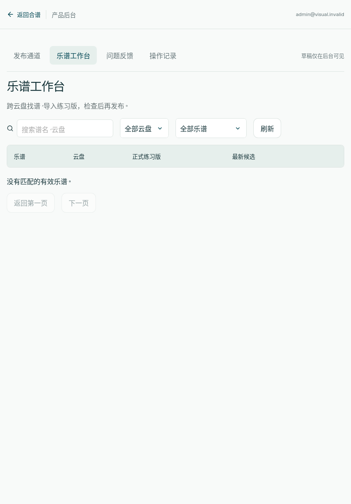
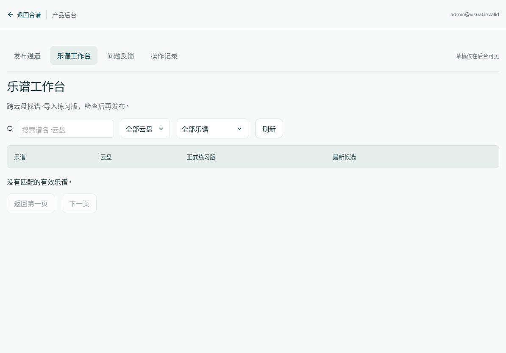
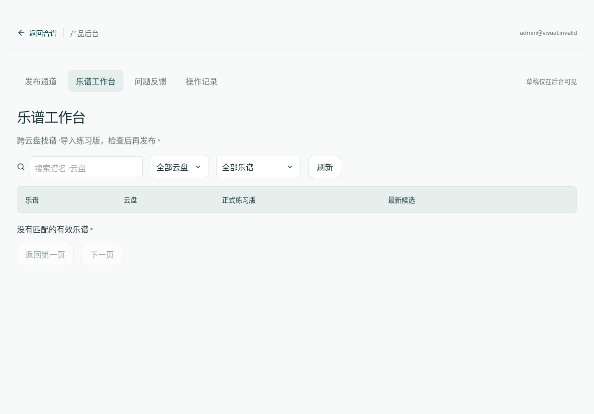
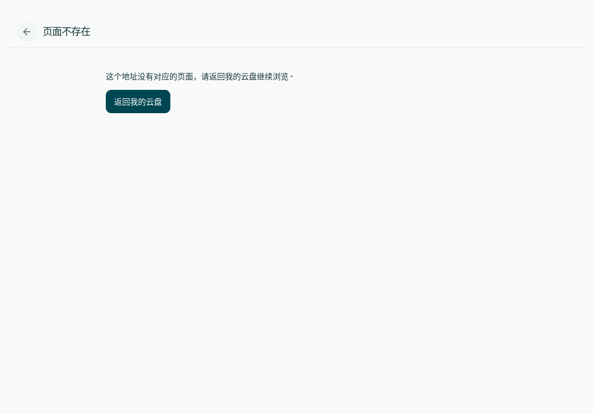

# 后台与 404 页安全区验证

基线：main `4bf2beca5234ddddc392ed5bb51923bf296589e9`。2026-11-16/17 UTC 在 Linux Playwright 1.64.1 Chromium / WebKit 中截图，使用实际应用与合成 API 身份 `admin@visual.invalid`、空谱目，不含真实邮箱、谱面或笔记。

复现：`SAFE_AREA_CAPTURE_TAG=before node --test --test-name-pattern='chromium: admin' visual-report/safe-area.test.mjs` 在修改路由前真实失败，后台 header y=0，期望 y=32。补充基线截图时暂时恢复上述 main 的 app.tsx，并仅在临时截图脚本中记录错误几何以继续收集；随后恢复修复。两引擎的后台、404 横竖屏基线均 y=0，修复后均 y=32，header 高度不重复增加，左右在安全边界内。

视口为 iPad 11 英寸常用 CSS 尺寸 834×1194 / 1194×834。注入现有 `--safe-*`：top=32、bottom=24、left=right=18px；这些是刻意非零的布局测试值，并非对某型号 iPad 实际 inset 的测量。截图是浏览器实际渲染截图，没有绘制虚假系统状态栏；留白是应用消费安全区的结果。零 inset 检查确认 header 仍从 y=0 开始。

| WebKit 页面 / 视口 | 修复前 | 修复后 |
| --- | --- | --- |
| 后台 834×1194 |  |  |
| 后台 1194×834 |  |  |
| 404 834×1194 |  |  |
| 404 1194×834 |  |  |

[Chromium 后台竖屏前](before-chromium-admin-834.png) / [后](after-chromium-admin-834.png)。

修复仅调整路由归属，复用既有 page-with-footer，不增加 CSS、安全区变量、全局 body padding 或页脚。所有后台分支、登录提示与 RouteContent 的加载/错误状态因此共享边界。路由审查还发现 404 同样绕过边界；其余普通页面已在外壳内。阅读器是明确的独立沉浸式布局，不加第二层补偿。独立更新诊断 HTML 未采用 viewport-fit=cover，无相同的路由外壳遗漏，本次未改。

实际检查：

- `npm run lint`、`npm run typecheck`、`npm run build` 通过。
- `npm run test:client`：167 文件、1457 测试通过。
- `node --test visual-report/safe-area.test.mjs` 分引擎执行：4/4 通过。除新增后台/404 横竖屏，还复用既有首页、关于、隐私、云盘 sticky header、云盘抽屉、安装弹窗，以及共享 portal 样式溢出检查；后者为合成 DOM，不是所有业务弹窗逐一验收。
- `node --test browser-tests/admin-workbench.test.mjs`：Chromium / WebKit 2/2 通过，在隔离本地 D1/R2 验证跨云盘导入、检查、发布，不操作生产。
- WebKit 缺少的系统库以 Debian 包解压至 /tmp 并放入临时浏览器库目录；实际启动并完成浏览器断言。运行时设 `PLAYWRIGHT_SKIP_VALIDATE_HOST_REQUIREMENTS=1` 跳过只检查系统路径的预检，不跳过测试或失败断言。

Linux WebKit 不是 iPad Safari，也未模拟 iPadOS 状态栏、PWA 安装模式、动态工具栏、虚拟键盘、旋转恢复与系统实际 env() 上报。未访问真实设备；仍需在真实 iPad 的 Safari 与已安装应用中验收后台横竖屏、旧安装、前后台切换及阅读器主动全屏。系统若错误上报零 inset，本修复与布局模拟不能证明能处理该平台异常。没有合并或部署。
