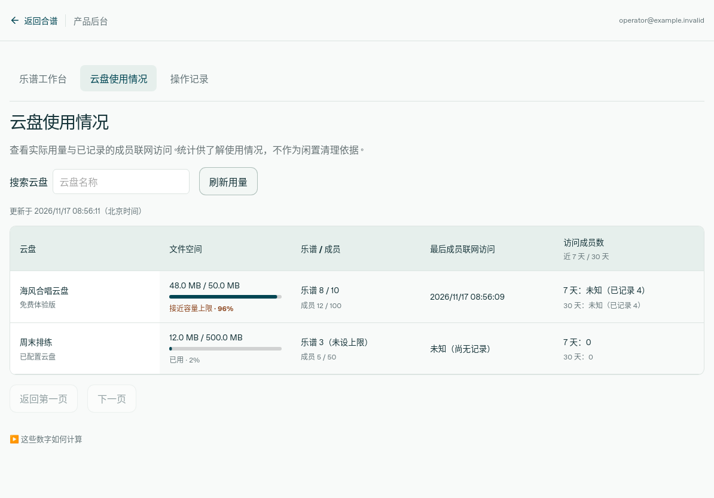

# 后台云盘使用情况

独立于 #671，开发过程中已跟进包含 #671 的 main `e566a69`；没有修改其路由安全区逻辑。入口为后台“云盘使用情况”（`/admin?view=usage`）。

展示实际文件容量、当前乐谱数、有效成员关系数与实际配置额度；达到容量 90% 提示接近上限。新增成员联网访问记录及滚动 7/30 天访问人数，历史未覆盖的窗口明确显示“未知（已记录 N）”，从未收到报告显示“未知（尚无记录）”。定义、采样误差、隐私与发布顺序见 [ADR-0022](../../adr/0022-record-foreground-member-visits.md)。

## 界面截图

Linux Playwright 1.64.1 / Chromium、WebKit；没有 iPadOS 或真实设备验收。截图使用合成邮箱、云盘名称、额度与访问数。真实本地 Worker/D1 链路先验证一名普通成员的访问进入汇总，以及同时为成员的运营身份被排除；随后只拦截该测试浏览器的 usage 响应以稳定展示 96% 容量、实际 100 人上限、新盘无记录、旧盘历史未知等场景。这些示例数字不是生产数据，也不是对真实云盘的用量判断。

[WebKit 竖屏 834×1194](webkit-834.png) · [手机 390×844](webkit-390.png) · [Chromium 横屏](chromium-1194.png)

小屏表格在有名称、可键盘聚焦的独立区域横向滚动，保留行列标题；未用隐藏页面溢出来裁掉列。截图不包含硬件安全区注入，#671 的安全区证据仍单独保留。

## 迁移与核心检查

- `0039_drive_visits.sql` 仅新增 nullable 云盘聚合时间、空的每成员最近时间表、采集起点与索引/触发器。不回填历史，不更改额度、身份、权限、谱面或笔记。
- 先迁移，再 Worker，最后客户端；回退代码保留新增表和字段，长期回退需维持成员级记录的三十天保留期任务。不执行生产迁移或部署。
- Worker 本地 D1 核心测试覆盖会话与身份 fence、非成员/运营身份/公开体验排除、普通用量读取不记账、并发与五分钟边界、滚动窗口、成员失效、元数据保留与级联删除。备用连接预检包含新请求头。
- 客户端核心检查覆盖后台与离线不发送、无定时心跳、恢复与身份切换；浏览器两引擎验证成员前台进入→授权后台展示，以及历史未知、实际额度和容量提示。
- 现有迁移验证增加存量内容、权限和额度不变及历史时间保持 null 的检查。完整本地客户端、Worker、迁移与构建结果随 PR 描述记录；GitHub CI 以精确 head 为准。

不新增通知、闲置工作台或任何云盘清理操作。成员级时间超过三十天后的定时删除仅用于最少数据保留，完全独立于云盘生命周期。
