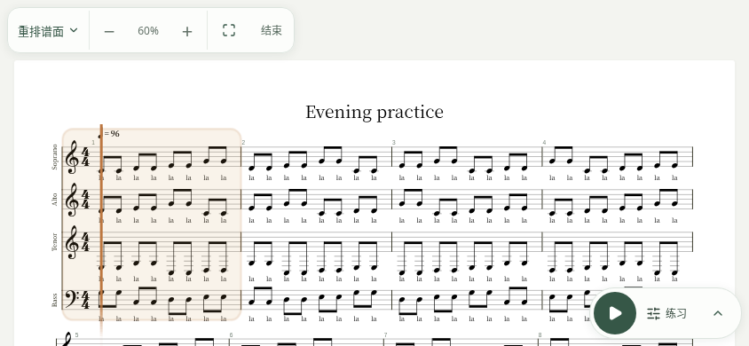
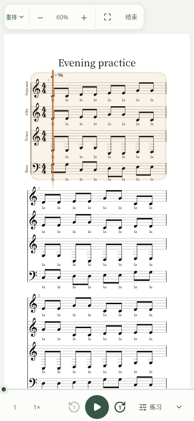
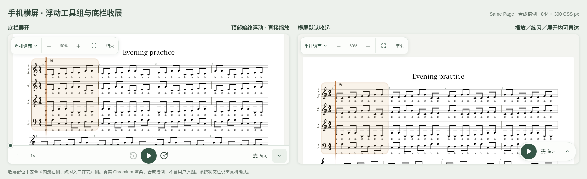
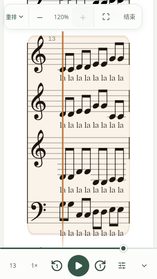
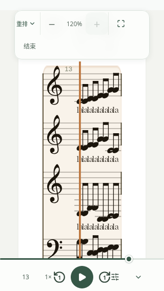

# 手机练习播放器 · 统一浮动工具组

PR #457 使用仓库原创合成谱例，不含用户原截图、用户谱面或真实云盘数据。

顶部在横竖屏均为一个紧凑浮动组，不预留整行布局：视图切换、直接缩小／比例恢复 60%／放大、全屏或专注、结束。原 PDF 不显示 XML 缩放；重排和对照直接提供加减，范围 30%–120%。手机使用简短模式名称与全屏图标，保留无障碍名称和键盘焦点。窄屏与较大安全区允许工具组换行，所有目标至少 44×44px。

底栏新会话竖屏默认展开、横屏默认收起；旋转保留本会话状态。用户手动选择持续有效，包括全屏进出。收展键始终在安全区内最右侧，练习入口在它左边；折叠后仍直接播放／暂停并打开练习。没有谱面点击切换或自动隐藏计时器。恢复跟随仍是不影响布局高度的浮层。

为减少遮谱，首屏内容留出工具组避让空间；自动跟随、定位及重排时，当前系统避开浮动组和视口边缘。超出可用高度的大系统对齐首行，保留手动浏览。工具组不在对照 XML 窗格内时不为该窗格额外留白。PDF 页码入口移到谱面左下方，避免与顶部工具组挤在一起。

## 实际截图

实际 Chromium 渲染，使用四声部、每小节八个音符的合成谱例。横屏 844×390 默认折叠，竖屏 390×844 默认展开；另检查 320px 窄屏、120% 大缩放和模拟安全区。







实际窗格与工具组坐标见 [geometry.json](geometry.json)。对照回归按安全区而不是固定顶部行高检查两窗格，严格验证等分、边界、分隔线和当前系统避让，并验证分隔比例、独立滚动和播放会话。

## 回归验证

```sh
PRACTICE_TEST_ENGINES=chromium PLAYWRIGHT_CHROMIUM_EXECUTABLE_PATH=/usr/bin/chromium node --test visual-report/practice-focus.test.mjs
PLAYWRIGHT_CHROMIUM_EXECUTABLE_PATH=/usr/bin/chromium node --test --test-name-pattern=chromium browser-tests/practice-reader-layout.test.mjs browser-tests/practice-unified-controls.test.mjs browser-tests/playback-ux.test.mjs browser-tests/musicxml-playback.test.mjs browser-tests/practice-compare.test.mjs
npx vitest run --config vitest.client.config.ts src/client/playback
npm run lint
npm run typecheck
```

视觉回归自行构建当前源码；默认运行 Chromium 与 WebKit。环境变量仅用于明确指定本地可用浏览器。截图保存在 CI 的 `artifacts/verification/practice-focus/`。保留真实 Worker 的进度拖动、位置、混音、循环、跨视图会话和准备复用验证，同时验证顶部不占整行、控件不重叠、安全区、直接缩放、手动偏好、旋转及跟随避让。远程结果以 PR #457 最新 CI 为准。

## 全屏边界

由用户手势调用 `requestFullscreen({navigationUI:'hide'})`，检测能力并监听退出。失败或不支持时使用可退出的站内专注模式，并说明无法强行隐藏系统状态栏。没有改 manifest、系统设置或安全策略。

[Fullscreen 标准](https://fullscreen.spec.whatwg.org/)保留浏览器和用户的退出控制。[MDN 兼容数据](https://github.com/mdn/browser-compat-data/blob/main/api/Element.json)列出 Chrome Android 支持，而 iOS 任意元素全屏仍限 iPad；[WebKit 说明](https://webkit.org/blog/13966/webkit-features-in-safari-16-4/#fullscreen-api)亦限 macOS／iPadOS。运行时仍以能力检测和实际结果为准。iPhone Safari／PWA 使用专注模式降级，不承诺隐藏 OS 状态栏；Android 和 iOS 的状态栏、真实安全区及旋转仍需真机验收。
