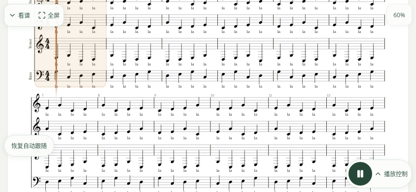

# 手机练习播放器 · 收展与专注模式

基于 main `6ea83a89ccc1ca916c8aebc83a214943d39ca92a`。全部截图使用仓库原创 SATB MusicXML 与模拟接口，不包含用户截图或用户谱面。

- 可用高度 ≤500 CSS px 的会话初次默认收起上下栏，浮动入口保留「看谱」「全屏／专注」「播放／暂停」「播放控制」。其他视口初次默认展开。
- 收展只响应明确按钮，没有谱面点击切换或自动隐藏计时器；旋转、动态视口、菜单和进度交互不覆盖当前选择。
- 收起栏只保留设备安全区，不再占整行布局。跟随浮层位于谱面内，避让浮动播放入口，出现／隐藏不改变谱面高度。
- 全屏直接由用户手势触发 `requestFullscreen({navigationUI:'hide'})`，检测 `fullscreenEnabled`，监听系统退出并恢复此前收展状态。退出失败仍保留退出入口和提示。不支持／请求失败时降级为可退出的专注模式，明确说明不能强行隐藏系统状态栏。
- 320px 窄屏下以图标收起和打开练习设置，无障碍名称及提示保留，触摸目标 ≥44×44px，控制命中区不重叠。嵌入式候选谱面审核保留原有展开操作。

## 实际渲染

Chromium 154（环境现有浏览器；Playwright 驱动）。844×390 横屏，展开谱面高度 **288px**，收起后 **390px**，增加 **102px / 35%**。设备安全区仍独立保留。浏览器模拟不包含真实 Android 系统状态栏；这些数值仅代表站内布局。





[测量结果](geometry.json)。截图由 `visual-report/practice-focus.test.mjs` 生成。

## 验证

```sh
npm run build
PRACTICE_TEST_ENGINES=chromium PLAYWRIGHT_CHROMIUM_EXECUTABLE_PATH=/usr/bin/chromium node --test visual-report/practice-focus.test.mjs
npx vitest run --config vitest.client.config.ts src/client/playback
npm run lint
npm run typecheck
```

浏览器回归默认在 Chromium 和 WebKit 运行；环境变量仅用于本地浏览器缺失时明确选择可用引擎。用生产预览验证真实 alphaTab worker，避免开发依赖预构建的 worker 路径问题。CI 已有构建产物和双引擎安装步骤；截图写入其现有 `artifacts/verification/` 收集路径。

本地结果：播放器 34 项通过；完整客户端 118 文件／1033 项通过；lint、typecheck、build 通过；完整 Node 单元 137 项通过、1 项失败（既有 `scripts/process-lifecycle.test.js > cleans a descendant even after its launcher exits`，本次未改进程清理）。WebKit 浏览器下载收到网络规则的 403 `Domain forbidden`，本地未能运行。完整远程 CI 取决于 PR 推送。

## 浏览器边界

[Fullscreen 标准](https://fullscreen.spec.whatwg.org/)要求用户激活，并由浏览器决定如何处理隐藏导航 UI 的请求；用户始终保留系统退出能力。Android Chrome 的原生 Fullscreen API 可请求隐藏浏览器／系统 UI，但不承诺具体设备永久隐藏状态栏，需真机确认。当前 [MDN 浏览器兼容数据](https://github.com/mdn/browser-compat-data/blob/main/api/Element.json)记载 Chrome Android 支持，iOS 的任意元素全屏只支持 iPad、不支持 iPhone；[WebKit 的说明](https://webkit.org/blog/13966/webkit-features-in-safari-16-4/#fullscreen-api)亦限于 macOS 和 iPadOS。运行时仍以能力检测和实际请求结果为准。

iPhone Safari 或主屏幕 PWA 不应被承诺可以动态隐藏 OS 状态栏；站内专注模式仅收起站内控制。没有改 manifest、系统设置或浏览器安全策略。iOS/PWA 实机状态栏、旋转安全区仍需真机验收。
