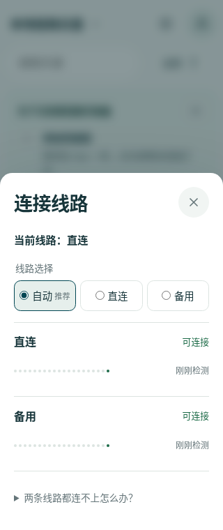
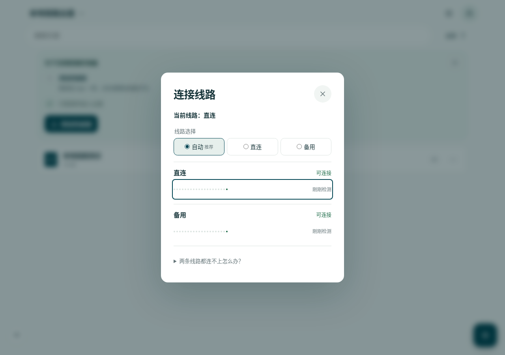
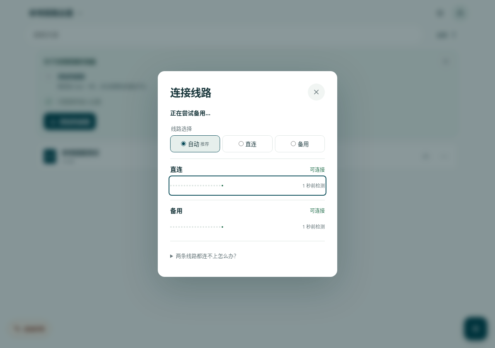
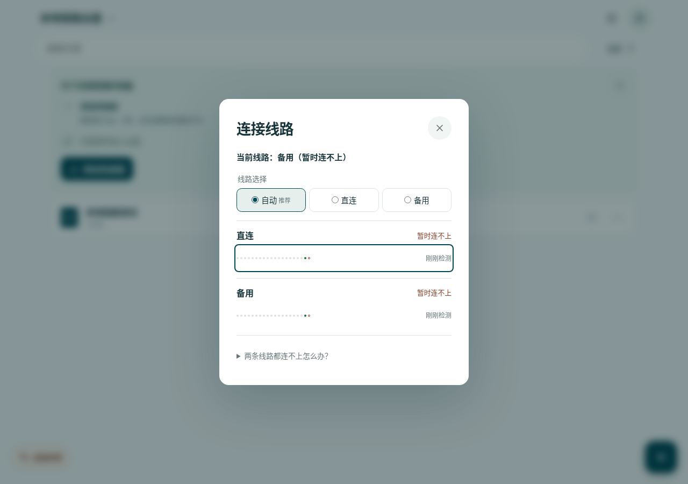

# 连接线路面板采样

基于 `65f1595d993e414f7e7ef3e74654f7c0b00abb62`，本次只修改客户端及本地测试，不涉及部署、DNS、服务端采集或持久历史。

## 展示与语义

主面板保留模式选择与两条线路，每路只显示最近一次结果、离散采样点和检测新鲜度。点按或键盘展开采样行，才显示入口服务、具体检测时间与健康探测耗时。实点、空心点、灰点分别表示成功、失败或超时、尚未检测；点按采样顺序排列，间隔不等，不能解读为连续可用性。45 秒后旧结果明确标为过期，隐藏时显示暂停。最近 20 次采样仅保留在当前页面内存。

周期只调用 `/api/health`：每轮两路并发，响应头和 JSON 体共用 3 秒期限，轮间不重叠。打开或恢复可见立即采样，切换模式取消旧轮并立即刷新。前两轮结束后等 10 秒；连续三轮结果相同后等 30 秒；结果变化重新回到 10 秒。长期稳定时新增预算约每分钟 4 个 GET；关闭、隐藏不继续采样。快速重开会等待已取消旧轮退出，避免重复周期。

周期采样不会刷新 session、交换凭证、重置业务故障冷却或切路。打开面板、用户主动选择模式、按需“恢复连接”和原有 online/visibility/业务恢复继续执行原有身份控制流程；这部分按需工作会独立产生请求。第一次打开可能同时有原有身份检测与独立采样，不将它们伪装成一次业务操作。没有主要“重新检测”按钮，身份缺失、冲突或无法确认时保留“恢复连接”入口。游客可通过既有入口重新确认身份。

`active` 继续通过 `useSyncExternalStore` 订阅。业务尝试另一条线路期间显示“正在尝试…”，成功确认后再显示当前线路；失败后不把尝试当成切换成功。最后选用线路不可达时明确注明“暂时连不上”。单次成功健康样本不会触发切路，原有两次、间隔至少 10 秒的回直连策略保留；中途出现身份冲突或未就绪会清空首次确认，不能在冲突解除后凭单次成功回切。

同时修复旧 generation 的 `check()` 健康/身份失败回写；为 `writeEndpoint` 和 `recoverMedia` 增加选路版本校验，迟到准备不覆盖同一身份代次中较新的选路。业务写入仍不跨线重放，身份精确校验不变。业务耗时不进入采样点。

## 视觉证据

均为合成本地数据、Chromium 154.0.8037.57，`reducedMotion: reduce`。未使用生产用户数据。

| 320 px 主面板 | 桌面主面板 |
| --- | --- |
|  |  |

| 正在尝试 | 双路失败 |
| --- | --- |
|  |  |

## 验证

- lint、TypeScript、完整 build（含预缓存预算与发布契约）通过。
- CI scope / release contract：30 项通过。
- player：352 项通过；Node 单元测试：57 文件、288 项通过。
- Worker：单元 8 项、集成 19 文件 199 项通过；本地乐谱与认证 migration 验证通过。
- 连接单元/组件：4 文件、55 项通过。覆盖登录、游客、冲突、慢响应头/响应体、超时、采样上限和请求预算、并发合并、关闭与隐藏恢复、快速重开、手动线路、旧身份响应、迟到原生上传/媒体准备、尝试与确认文字订阅。
- Chromium 原有双线端到端回归通过：真实跨入口 cookie、冷启动切路、固定线路、丢失上传确认不重放、音频状态与 Range、备用站点入口。
- Chromium 邀请码链路回归最终 7 项全部通过（重新确认期间保留输入、慢响应头/响应体、双路超时、手动线路、离开页面取消）。早先与完整客户端/构建并行时 headers/body 的当前线路断言和 cancel 的备用请求数断言失败；随后独立 main 对照与当前分支无其他重型任务并发的复核均 7 项通过，未修改断言。
- 新增 Chromium 场景检查 320 px、桌面、触屏配置、键盘展开与 Escape、reduced motion 偏好、实时切路文字、双路失败、面板关闭后业务恢复、手动模式、周期停止及隐藏恢复。

完整客户端首次运行：151 文件通过、1 文件失败（1322 项通过、1 项失败）；`drive-switch-history` 在 1 秒内未等到云盘数据，单独复核通过。第二次完整运行：152 文件通过、1 文件失败（1323 项通过、1 项失败），为 `app.test.tsx` 的 StrictMode 自动游客准入在 1 秒内未等到页面；该文件单独运行 41 项全部通过。未为这些超时修改测试实现或门槛。

本环境 Playwright 固定版本运行包下载返回 `403 Domain forbidden`，改用本机 Chromium，并仅在本地测试启动器对 loopback 测试域名禁用代理和固定解析。WebKit、整套 visual/smoke、完整 PWA/性能门禁未在本地执行，需要 PR CI 补齐。屏幕阅读器语义由 DOM 可访问名称和状态测试覆盖；未手动运行 VoiceOver/NVDA。
