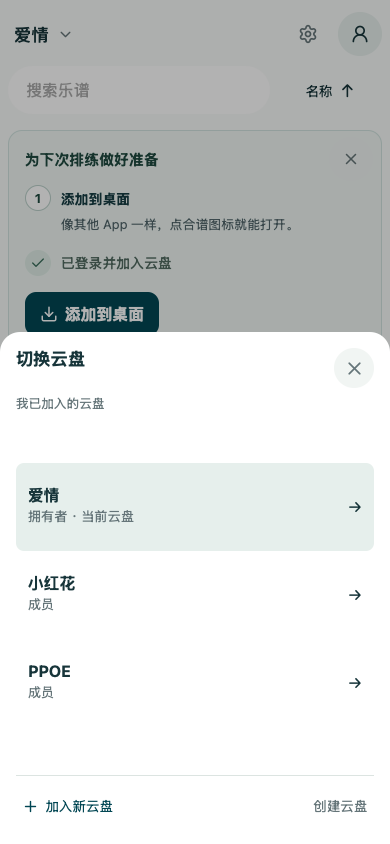
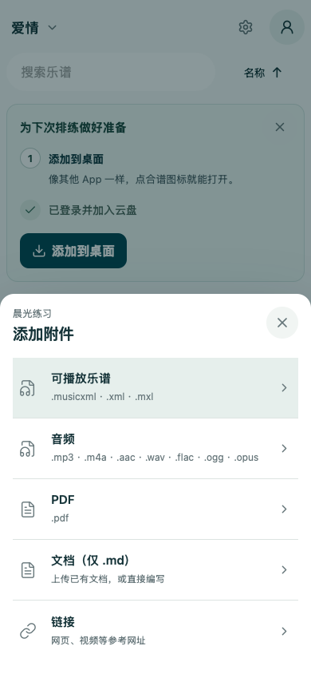
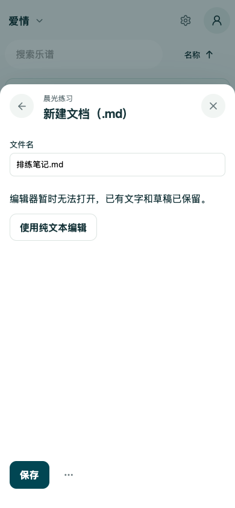
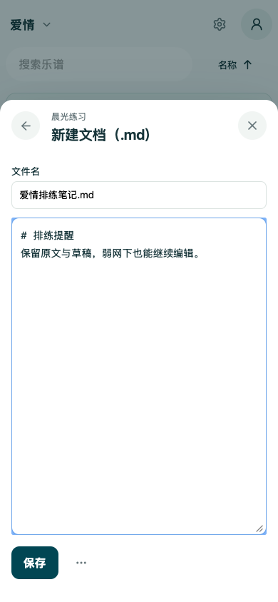
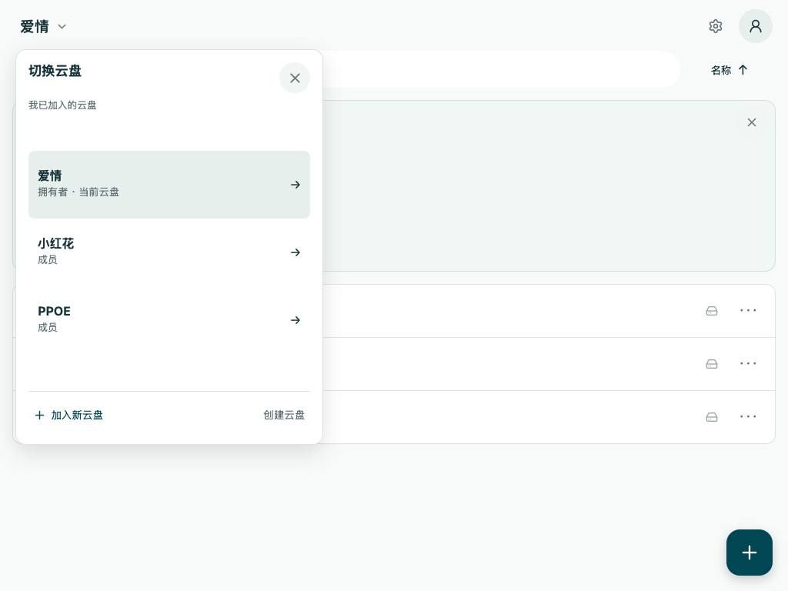

# 附件入口与云盘上下文验证

对应 [#533](https://github.com/clydian/same-page/issues/533)，业务代码验证版本 `44469747e4cb25135c6f1ac82f87b867f31ebc7b`。

## 最终行为

- 附件类型、基础上传表单与文档外壳随应用缓存；支持 MusicXML、音频、PDF、Markdown 和链接。只有增强编辑器与 PDF 预览按需加载，失败局限在附件窗口。编辑器失败可使用纯文本，沿用原文、草稿、权限、保存和未保存退出保护；PDF 预览失败提示附件菜单下载、检查更新和反馈。
- 云盘名称与成员/拥有者共享完整展示缓存，近期重开不重新等待；后台更新保持已有行的顺序、key、尺寸和面板位置，新行追加进固定滚动区。确认失权禁用对应行，重开不恢复点击能力，确认空结果/拒绝不被旧缓存覆盖。
- 普通切盘使用替换入口，已退出云盘的历史任务不重新挂载；盘内层级返回与附件系统返回保留。当前盘普通点击只关闭选择器，修饰点击保留新标签；刷新恢复同时核对历史 key 与路径，显式新深链接保持正常。

未修改数据库版本、既有数据或服务端授权。新增快照使用可选且按用户隔离的命名空间，退出登录会清理。展示缓存不授予上传/管理权限。

## 已完成的验证

- Node 单测 290 项、客户端单测 1165 项，原始 `npm test` 通过；lint、TypeScript（build 内的 `tsc -b`）、构建及 precache 预算检查通过。127 项 precache、去重后 6,905,831 bytes，低于 7,340,032 bytes 预算。
- 新增真实构建浏览器用例：Chromium/WebKit，各跑手机和横向平板。按住 PPOE 行时释放倒序响应，同时改变身份并追加新盘；四种组合中原目标矩形完全不变。还覆盖近期重开请求次数、切盘与盘内返回、新显式深链接、类型/PDF 表单不依赖可选模块、编辑器 503 后纯文本保存、上传原文字节及附件系统返回。
- 既有 drive-navigation、drive-navigation-settings、drive-library-lifecycle、responsive-navigation 浏览器回归 48 项通过；诊断 Worker 针对性回归 16 项通过。
- Standards / Spec 双轴最终 review 均为 0 项；前轮发现的模块假重试、面板增长、历史身份、撤权重挂载及无效响应夹具已修复并复验。

一次同时运行浏览器与默认并发全量客户端时，3 项既有一秒等待超时；对应 122 项独立回归、四 worker 全量和随后原始默认全量均通过。没有放宽超时或新增自动重试；这些结果不能单独证明最初等待超时的根因。Linux 最终头 CI 在 PR 中另行呈现。

首轮 Linux CI 另发现两处新行为相关的测试前提过时：附件已静态化，旧 loading-stability 用例仍等待 attachment-dialog 懒加载请求；以及保存回执预览先于目录刷新完成，立即 Back 会被既有 busy 保护取消。测试现改为验证静态入口不依赖旧 chunk、把迟到模块取消验证移到替换 PDF，并等待明确的保存完成标记再验证 Back。对应 Chromium/WebKit 2 项 smoke 和 2 项四视口新浏览器用例通过。邀请流程曾在 WebKit page.goto(load) 15 秒超时，独立 4 项回归通过但未证实根因，现仅补现有 withBrowserEvidence，不改变时限/行为/断言。

## 截图与证据

以下为真实构建下的合成账户/谱目夹具；并非生产用户截图。[用例](../../../visual-report/drive-context-attachments.test.mjs)生成原始图片与几何记录，[结构化结果](evidence.json)保存四种组合的前后矩形。

| 手机切盘列表 | 手机附件类型 |
| --- | --- |
|  |  |

| 编辑器失败保留文档外壳 | 纯文本备用入口 |
| --- | --- |
|  |  |

## 验收边界

这里验证的是浏览器引擎、请求失败和导航逻辑，service worker 在该合成测试中被禁用。实体手机安装态的系统返回、软键盘、离线缓存以及后台回收仍需实机验收；没有据此声称已完成 iOS/Android PWA 实机验证。缺少原附件事故的诊断回执，不能把本次可复现的模块失败路径当作两次历史事故的唯一根因。此分支未合并或部署。
