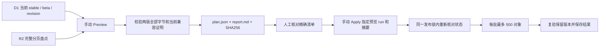

# 一次性清理前端历史版本

Issue #607。本次授权只保留执行时 D1 指向的当前 stable 和 beta 的完整资源，
不区分其他版本是否曾经作为 stable。它不是长期保留策略，也不会自动运行。

只操作私有桶 `same-page-frontend-releases`；不修改 D1、Worker、乐谱桶、Android 桶或本机数据。
D1 的发布、兼容证明和提升审计记录保留，历史版本失去完整资源后，后台可能显示版本信息不可用。
这是 ADR-0021 暂不回收服务端版本的**一次性、明确授权的例外**。



## 1. 合并 PR 只安装工具

合并后不会删除文件。`One-off frontend release cleanup` 仅允许在本仓库 `main` 上
手动触发，没有 push、定时或 PR 删除触发器。preview/apply 和正常部署都使用
`same-page-production` 锁，等待正在上传、部署、准入的任务结束。
不要同时从本机或其他未使用该锁的工具修改发布桶或通道；清理期间也暂停后台提升。

工作流使用现有 production environment 的 `CLOUDFLARE_ACCOUNT_ID`、
`CLOUDFLARE_API_TOKEN`，沿用现有 R2 S3 凭据派生方式。
凭据须具备该桶的对象列表、读取、删除及 D1 catalog 读取权限。
不需要改为公开桶，不设置对象 TTL，不提供整桶清空参数。

## 2. 第一次运行选择 preview

在 GitHub Actions 手动运行工作流，保留默认 `mode=preview`。另外两个输入留空。
下载成功运行的 `frontend-cleanup-plan-<run>-<attempt>` artifact，检查：

- stable、beta、revision 是否对应当前通道；相同版本只保留一份。
- 待删除的历史版本目录、对象数和总字节数；**精确清单以 plan.json 为准**。
- 所有 `disposition=keep` 的当前版本对象均保留，包括清单外的额外对象。
- 只有 `releases/<40位SHA>/...` 且不属于当前两版的对象标为 `delete`，
  包含未完成上传留下的历史候选对象。
- `legacy/` 共享资源、`legacy-claims/`、全部 `compatibility/` 小型审计记录及未知前缀
  标为 `review`，本轮保留；报告逐项列出。不能把“只保留两版”理解为直接取反清空整个桶。
  legacy 的客户端依赖需要另行核对后才能删除，不能仅凭上传时间判断。

预览已按 D1 记录的 seal 摘要核对两版清单，读取并核对全部前端文件的 SHA256/大小，以及 Worker 分发必需的 SHA256 元数据，
以及 claim、storage、probe 和当前 stable/beta 兼容证明。缺失、损坏、分页异常或期间通道变化
都会使预览失败，失败运行不能作为 apply 的来源。

人工核对完清单后记录预览 run ID 和报告中的 **plan.json SHA256**。
先把真实清单交给本次清理的授权人核对，再进入下一步。

## 3. 手动 apply 精确计划

在同一个 main 源码版本再次运行该工作流：

- `mode=apply`
- `preview_run=<已核对成功的预览 run ID>`
- `plan_sha256=<报告中的完整 SHA256>`

工作流仅下载本仓库同一工作流、main、成功的 workflow_dispatch、同一源码 SHA、
最新成功 attempt 的预览 artifact，并校验下载摘要及 plan.json 摘要。
预览 artifact 保留 14 天；过期、main 已更新、通道或对象发生变化时重新预览并核对。

删除前再次校验两版完整资源和 catalog；每批前重新读取 catalog 和完整对象列表。
新增对象、对象 ETag/大小改变、保留对象消失均停止。每批至多 500 个精确对象，
逐项核对 R2 的 Deleted/Errors，保存 `apply-result.json`。网络不确定、权限错误和部分失败
均停止，不扩大删除范围。已成功删除的计划内对象可在重试同一计划时跳过；
通道 revision 或控制代码改变则必须重新预览。

生产锁防止正规发布和清理交错；它不能约束绕过工作流的手动 R2 写入，
因此不要在清理期间运行其他发布工具。后台提升只可能提升已保留的当前 beta，
两版都受保护；revision 改变仍会让后续批次停止。

## 4. 验收与失败处理

脚本结束前再次核对所有计划删除对象已消失、两版资源哈希仍正确。
成功表示资源层面验收通过；随后分别在线打开 stable/beta，检查更新、阅读和练习谱播放。
保留预览报告、明确确认记录和 `frontend-cleanup-result-<run>-<attempt>`（90 天）作审计。
若失败，先检查 journal 和工作流日志；不要手动整目录补删，也不要覆盖 immutable 对象。

R2 删除不能撤销。清理后的旧客户端可能无法获取尚未缓存的历史懒加载资源，
本次按授权不再支持两版之外的历史资源。当前正在使用的 stable/beta 必须先确认正确。
本 PR 不增加客户端更新强制策略；清理也不会清空浏览器已有缓存或用户数据。

本地回归：

```sh
npx vitest run --config vitest.node.config.ts scripts/frontend-cleanup.test.js
```

本地只有 `preview` 读取模式；实际 apply 强制在受控手动生产工作流内运行。
