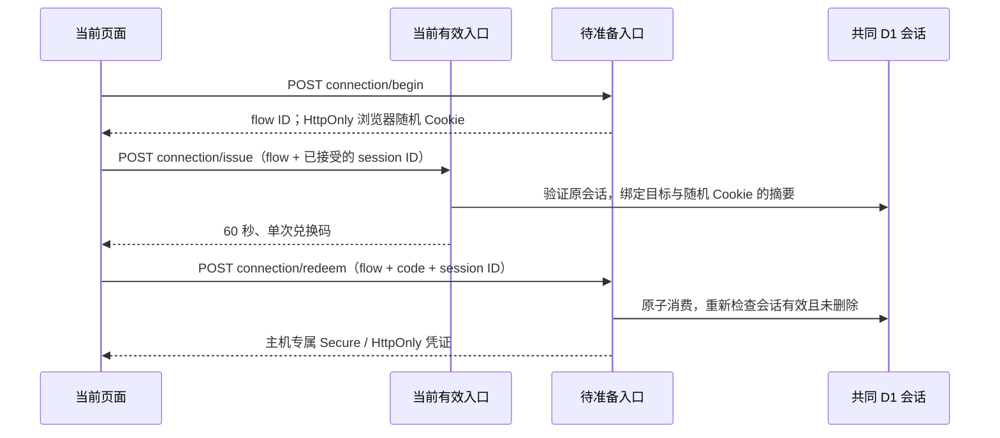

# #580：双入口连接控制与受控上线

本次测试与评审见 [验证记录](verification-580.md)。需求以 [已确认方案](https://github.com/clydian/same-page/issues/580#issuecomment-6420913816) 为准。
[ESA 试验记录](issue-580-esa-backup.md) 和 [原始脱敏结果](issue-580-esa-evidence.json) 记录的是公开读取验证；本变更的本地测试不替代生产和大陆网络验收。

## 页面入口与业务线路

正式网址 `https://samepage.clyapps.com`，应急网址 `https://samepage-alt.clyapps.com`。
两个页面均能选择直连／备用 API。页面已加载时切线不导航、不更换 IndexedDB；首次连 HTML 都打不开时，只能另开应急网址。两个网址的本机草稿、离线副本及 PWA 各自保存；不能用换网址代替未同步草稿的处理。

文件库、云盘列表和登录页左下角的连接按钮与上传按钮共用滚动规则。下滑隐藏、上滑出现；键盘焦点、检测及连接故障时保留。面板显示模式、自动选择的实际路线与两路连通结果，仅真实登录异常时提示。健康检查成功不会改写保存或同步结果。原有具体操作失败／本机校验／重新登录提示保留。正常连接按钮仅显示灰色 Wi-Fi 图标，检测时显示转动图标；仅异常时增加短标签。自动选项带轻量“推荐”标记。面板省略常规登录核对、耗时与检测时间，列出 Cloudflare 和阿里云 ESA（境外节点），并在折叠帮助中说明两路均不保证大陆访问稳定。手动模式通过线路选项切换，省略重复的故障标题、解释和快捷改用按钮；两路状态保持直观。网络故障不引导重新登录。帮助默认折叠为“两条线路都连不上怎么办？”，提供更换 Wi-Fi／移动网络或尝试已有可用 VPN 后重新检测的建议，不承诺必然恢复。

## 协议与认证

ESA 保留 canonical Host/SNI，因此不信任 `X-Forwarded-Host` 来决定凭证或回调来源。新增公开路由：

- `/api/_entry/direct/<path>` 对应直连公共入口；
- `/api/_entry/backup/<path>` 对应备用公共入口；
- Worker 在派发业务前将它们映射回原 `/api/<path>`。

路径是路线选择，不是认证。只能选择配置中的两个 HTTPS 同站兄弟主机，不能指定任意上游、任意回调或任意 Origin。浏览器决定 Cookie 归属实际访问的主机，后端不设置父域 Cookie。所有业务仍使用原授权、用户生命周期和实时云盘权限检查。新路线不修改旧 `/api/*` 的响应协议。

认证流程：

- `connection_exchanges` 是增量表；短凭证只在 POST body 与页面内存传递。数据库只保存码和浏览器随机数的 SHA-256 摘要，定时清理过期项。
- 入口凭证是服务端签名的 session ID、目标 audience、到期时间及原生 Cookie 指纹。它不包含 Better Auth 原始 session token。每次实际使用均查 D1 原会话，再在后端适配给 Better Auth；不创建新会话，不修改 `createdAt` 或重新认证方式。原会话撤销、过期、密码重置、删除后立即拒绝。
- 优先采用有效的显式登录 Cookie。原生 Cookie 已变化时，旧兑换凭证即使迟到也不能恢复更早身份；目标已有不同有效 session 时兑换返回 409，不能覆盖。页面另有代际检查，退出、切换用户或模式时隔离迟到读取和准备。
- 明确密码登录后仅为传输校验识别新的原生会话；本机归属仍须通过原有 logout fence 接受。恢复专用原生会话可以读取用户恢复页，但不授予产品访问，也不能兑换另一入口凭证。
- 正常请求仍按 Better Auth 原有 180 天 idle 策略续期，续期 Cookie 由当前主机保存；前台凭证准备的 status 请求也通过集中会话读取转发正常续期 Cookie，避免备用主机长期未承载业务而独自过期；入口凭证的 180 天寿命不是独立会话有效期。目标凭证丢失或过期时，在有效源入口重新准备，不延长已撤销会话。
- 仅备用可用时退出会撤销共同 session，原端残留 Cookie 不能再授权；两路均断遵守原有“服务端退出未完成，不清本机数据”的行为。
- 新业务请求携带预期 session ID，服务端每次核对实际身份。原生音频／文件不能设置自定义请求头，因此以 `_sp_session` query 传递这一非秘密 ID，并在业务派发前移除。它只用于拒绝身份不一致，不能替代 Cookie 认证。即使另一窗口在备用网站切换用户，已缓存的“就绪”状态也不会放行另一用户数据。
- CORS 只允许配置中的两个精确 Origin，带 credentials；不允许通配、任意请求头或无 Origin 的新路由写入。旧直接客户端路径保持兼容。
- 首次在备用页面用邮箱密码登录不依赖直连；恢复后反向准备直连。首次恢复先读取当前页面主机自己的登录，避免另一主机的旧用户成为当前本机归属。自动恢复只能采用以前已接受的确切 session；另一路不同用户不会胜出。
- Google 继续使用原已注册入口；备用 route 及来自备用页面的跨源请求不提供 Google provider，避免生成未注册回调或承诺第三方可达。需要扩大 Google 回调时另做 OAuth 注册及跨浏览器验证。
- 访客 `POST /guest/session` 仅签发无状态准入 Cookie，不创建成员关系或业务数据，允许网络故障时切线重试，也允许显式为另一线路重复准备。该例外不适用于普通 POST。准入版本和当前云盘状态仍按原规则检查。

## 线路与写入策略

默认自动、直连优先；网络 TypeError／本层超时可在同一次 GET／HEAD 中至多尝试两条路线，9 秒总预算、每次建连最多 4 秒；收到响应头后释放建连期限，正文下载仍由业务原有期限和取消控制，避免慢速大文件在 4 秒被中断。调用者取消、401／403／404／409／429、502／503 等 HTTP 响应原样返回，不盲目切线。失败记录在页面内共享，冷却从约 15 秒按指数增长到约 120 秒并加抖动。重新探测共用一个在途 Promise。

邀请码准入的 `POST /api/guest/session` 是唯一可切线重试的写方法例外：每路 4 秒期限覆盖完整的小 JSON 响应（最多 64 KiB，并验证 schema），不能仅收到 200 响应头就当作进入成功。直连在响应头前或正文中卡住，都可自动改走备用；成功后不立即再准备刚失败的路线。`enterDrive` 的 9 秒总预算还覆盖后续登录用户的 join-state 读取／访客凭证清理；超时停止等待、保留邀请码并允许重试，提交中输入只读。调用方取消、离开页面、新登录／新准入意图会隔离旧流程；手动固定路线仍只用指定路线。正式创建成员关系、上传等业务写入维持单次提交。开关关闭时也有 9 秒进入等待上限，但不提供双路切换。

备用生效后，直连需两次前台确认、至少间隔 10 秒才恢复；备用读取在冷却后可按需触发探测，每 30 秒至多一次，没有持续业务轮询。手动模式严格指定路线，健康检查不能改选。

统一 fetch 控制覆盖会话、文件库、笔记及设置；XHR 上传使用同一选择并验证确切身份，带 credentials，沿用原上传期限。原生 PDF、附件下载和音频使用当前验证过的入口 URL；PDF 文档初始化期间的网络失败可按同一身份换路至多一次，音频网络故障换路后保留播放位置／速度／音量。解码错误和权限错误不视为线路故障。

所有已提交的业务写入都不由线路层重放：

| 操作 | 响应丢失后的处理 |
| --- | --- |
| 笔记 | 原 outbox 和 `opId` 继续负责幂等与确认 |
| PDF 创建、替换、删除、设置与成员变更 | 保留原结果待核对／错误状态，由业务恢复流程处理 |
| 附件 PUT | 保留原客户端 attachment ID、revision 及 recovery 查询，不改成线路级自动重传 |
| XHR 上传 | 保留进度和在途结果；网络失败后队列暂停核对，不重复创建 |

## 上线与回退

两个开关默认均关闭：后端 `CONNECTIONS_ENABLED=false`，前端不设置 `VITE_CONNECTIONS_ENABLED`。
旧客户端、现有存储版本和已部署的稳定／测试版协议继续工作，本地数据库无升级或清理。

1. 先在测试环境应用 `0037_connection_exchanges.sql`，再部署向后兼容后端。确认 `CONNECTION_BACKUP_ORIGIN` 与证书／ESA 回源一致，仍使用原 `BETTER_AUTH_SECRET`，不需要把秘密发给 ESA。
2. 在受控环境启用后端开关。确认 ESA 对新增前缀、OPTIONS、POST、Set-Cookie、Range、Content-Range 及 Origin 原样转发，并继续绕过所有业务缓存。不要改变源站 Host/SNI 或关闭证书验证。
3. 按现有 beta release 流程构建 `VITE_CONNECTIONS_ENABLED=true` 的客户端；可用 `VITE_CONNECTION_PRIMARY_ORIGIN`、`VITE_CONNECTION_BACKUP_ORIGIN` 覆盖本地测试网址。生产默认是上面的两个正式域名。不要仅启前端，否则新路由返回 404。
4. 在真实 ESA、Chromium／WebKit、移动设备／PWA 上验收双向登录、冷启动直连断开、仅备用退出、密码重置／用户删除／失权、PDF 分片、音频拖动、上传及笔记。原站 get-session 只读限额为每分钟 60 次，密码／验证码限额保持原值；连接检查仅在需要恢复或实际换路时重新获取产品会话。用大陆无代理的 Wi-Fi 和手机网络收集收益。公开健康检查双通不代表业务已通过。
5. 确认 beta 与稳定版升级、降级保留草稿，再考虑默认开启。此 PR 不执行生产部署、续费或扩大流量额度。

回退时先发布／指定关闭功能的客户端，等待已启用客户端退出受控窗口，再关闭后端新路由；可保留增量表待以后清理。不要先关后端让仍启用的客户端持续 404。旧客户端继续原路径工作；紧急时可回退到上一客户端 release。回退不复制或删除本机草稿，不主动删用户或共同 session。

ESA 基础套餐到期与 1 GB 试验限速仍按原试验记录管理；未完成生产验证前不扩大试验范围。

## 可复现检查

- `npm run typecheck`、`npm run lint`、`npm run build`
- `npx vitest run --config vitest.client.config.ts src/client/connection/controller.test.ts`
- `npx vitest run --config vitest.worker.config.ts worker/connection/connection.test.ts`
- `node --test browser-tests/connections.test.mjs`

浏览器测试用临时自签 TLS、本机 workerd／D1／R2，以及解析到 127.0.0.1 的两个 nip.io 兄弟主机；忽略的仅是测试自签证书，生产证书校验保持开启。测试记录路线及方法，不记录 Cookie 值或真实用户。浏览器证据在忽略的 `artifacts/verification/issue-580/`。
