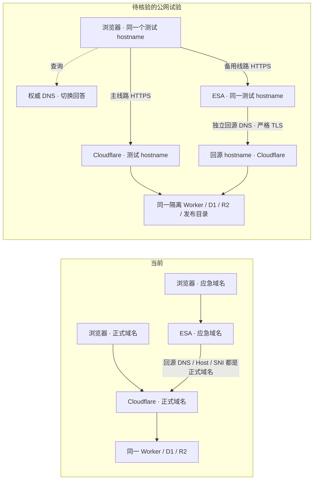

# #614 同域名双入口验证

## 需求和判断

主入口失效时，浏览器仍打开 `https://samepage.clyapps.com`。首次导航、浏览器管理的根 scope `/sw.js` 和在线许可 `/api/client-release` 都须由备用入口提供。两路共用登录会话、发布目录和 Worker/D1/R2。稳定版/测试版按照同一个主机专属 HttpOnly Cookie 服务端读回，过期回到默认稳定版。本机草稿、离线数据、发布准入和多窗口交接沿用 ADR-0021。范围是用户到入口的路径故障；共享后端停机时沿用当前离线行为。 [#614](https://github.com/clydian/same-page/issues/614) · [ADR-0021](../adr/0021-release-channels.md) · [Service Worker 更新算法](https://w3c.github.io/ServiceWorker/#update-algorithm)

该需求明确且合理。下面的公网拓扑是待验证方案。维护者还需决定是否接受先由值班人切换、哪些运营商/区域的局部故障需要自动覆盖、故障确认和切回等待窗口、预算及可接受的恢复时间。DNS 切换由解析层生效，远端监控即便健康，某个用户到 Cloudflare 的路径仍可能中断。

## 当前路径与候选路径



- 仓库的 Worker 通过正式 Custom Domain 绑定，关闭 `workers.dev` 和 preview URL。#580 记录 ESA 使用正式域名回源。若让正式域名解析到 ESA，原回源将再次命中 ESA。回源 hostname 必须拥有独立解析链，且始终调用同一后端。Cloudflare 接入和共享后端仍是共同依赖。 [Wrangler 配置](../../wrangler.jsonc) · [生产发布](production-release.md) · [#580 现有 ESA](issue-580-esa-backup.md) · [连接控制](issue-580-connections.md)
- 2026-11-28 Codex Cloud 公开只读抽查：`clyapps.com` 使用 Cloudflare 权威 NS；正式域名返回 Cloudflare A/AAAA，备用域名 CNAME 为 `samepage-alt.clyapps.com.a1.initxa.com`，均观察到 300 秒 TTL。两域 `/`、`/sw.js`、`/api/client-release` 均返回 200 和 `private, no-store`；备用响应含 ESA Via、`DYNAMIC` 和上游 `CF-Ray`，许可请求的后台 build 均为 `746eeee6c93407102051723fe58f1256cda98942`。#580 的套餐到期记录是历史快照；公开读取看不到当前套餐、证书开关或账单。 [#580 试验记录](issue-580-esa-backup.md) · [Cloudflare TTL](https://developers.cloudflare.com/dns/manage-dns-records/reference/ttl/)
- Cloudflare Worker Custom Domain 要求活动 zone、精确 hostname，建绑定时创建 DNS 记录和证书，已有同名 CNAME 会阻止创建。文档支持在 Business/Enterprise 的 **partial zone** 由外部权威 DNS 指向 `<hostname>.cdn.cloudflare.net`；Cloudflare Registrar 域名不支持 partial setup。组合使用时要实测 Worker 绑定、切到 ESA 期间的证书续签与回切。Cloudflare for SaaS 的迁移预验证文档支持分步骤切换，但另一 CDN 可能遮住验证记录；这不构成长期双活或续签承诺。Cloudflare 代理模式的 CNAME 也可能拒绝另一 CDN 的目标。 [Custom Domains](https://developers.cloudflare.com/workers/configuration/routing/custom-domains/) · [Partial setup](https://developers.cloudflare.com/dns/zone-setups/partial-setup/setup/) · [SaaS hostname 验证](https://developers.cloudflare.com/cloudflare-for-platforms/cloudflare-for-saas/domain-support/hostname-validation/) · [代理 CNAME 限制](https://developers.cloudflare.com/dns/manage-dns-records/reference/dns-record-types/)
- ESA CNAME 接入需完成站点归属验证并配置线路。公开规则表列出各套餐可分别设置回源 DNS、HTTP Host、协议和 TLS SNI，ESA 的 DNS 文档也明确禁止把加速域名填作自己的源站。HTTPS 回源默认不校验证书，试验须启用并验证域名、根链和有效期。优先测试解析、Host 和 SNI 同为独立回源 hostname；另测仅将 HTTP Host 改为测试页面 hostname 的组合，任何依赖主入口绑定或不通过严格校验的组合都不能采用。浏览器运行时的认证、回调和 Cookie 仍以外部 canonical origin 为准。 [ESA 接入](https://help.aliyun.com/zh/edge-security-acceleration/esa/getting-started/add-your-website-to-esa) · [ESA DNS 记录](https://help.aliyun.com/zh/edge-security-acceleration/esa/user-guide/get-started-with-dns) · [回源规则](https://help.aliyun.com/zh/edge-security-acceleration/esa/user-guide/back-to-source-rule-overview/) · [源站证书校验](https://help.aliyun.com/zh/edge-security-acceleration/esa/user-guide/back-to-source-protocols-and-ports)
- 两个边缘证书都要覆盖同一个浏览器 hostname，有效期及续签需要在另一线路接流量时通过。CNAME 接入 ESA 可委托 DNS DCV 提前签发。若 Cloudflare Advanced 和 ESA 都要求独占同名 `_acme-challenge` CNAME，应先明确供应商支持的替代证书/DCV 方式及 CAA，再继续。Cloudflare 代理 DNS TTL 固定 300 秒，DNS-only 通常最低 60 秒、Enterprise 可 30 秒；递归缓存、A/AAAA、CNAME 链、浏览器连接与缓存都影响客户端生效时间。HTML、SW、许可、认证及业务 API 初始对两路显式绕过边缘缓存，保留 `private, no-store`；禁用 stale 与重定向跟随。 [ESA 托管 DCV](https://help.aliyun.com/zh/edge-security-acceleration/esa/user-guide/managed-dcv) · [Cloudflare 委托 DCV](https://developers.cloudflare.com/ssl/edge-certificates/changing-dcv-method/methods/delegated-dcv/) · [ESA 缓存状态](https://help.aliyun.com/zh/edge-security-acceleration/esa/user-guide/default-cache-rule) · [Cloudflare TTL](https://developers.cloudflare.com/dns/manage-dns-records/reference/ttl/)

## 隔离验证

```sh
SAME_PAGE_RELEASE_CHANNELS=1 npm run build
node scripts/verify-same-origin-entry.mjs
```

运行需要已安装项目依赖、Chromium 和 OpenSSL。可用 `PLAYWRIGHT_CHROMIUM_EXECUTABLE_PATH` 指定系统 Chromium。复用隔离 Workerd/D1/R2 和发布目录 fixture。两个本机 HTTPS listener 通过 TCP 转发选择，同一个 `https://app.same-page.test:<port>`；切换断开旧连接。Chromium 只对当次临时边缘证书公钥使用例外；回源使用独立证书和严格名称校验，校验 HTTP Host 与 SNI。测试使用真实应用密码登录、发布通道界面和浏览器管理的 SW。发布 fixture 把稳定版和测试版指向同一个本地构建，用来核对选择及目标是否保持；草稿通过产品存储命令写入实际 IndexedDB。此环境模拟入口选择，公网 DNS/TTL 及两个厂商的证书与回源能力仍需下表验收。

2026-11-28，Chromium 154.0.8037.57、应用构建 `746eeee` 通过验证。主监听器关闭后，空 profile 首访失败；切到备用后同一 URL 加载 HTML，浏览器取得并激活根 SW，在线许可返回默认稳定版。已有 profile 在主 → 备 → 主过程中保留同一会话、测试版 Cookie、许可目标与草稿。显式切回稳定版后的 Cookie 和许可也跨入口保持。备用回源的错误 SNI 返回 502，未读取缓存替代许可。

## 公网试验与验收

仅在批准后执行。**第一步**用已有或新批准的独立测试 zone，指定 `app.<测试域>` 和 `worker-origin.<测试域>`，部署隔离 Worker、D1、R2 和两份兼容的测试发布制品，只用合成账户。给 Cloudflare 两个测试 hostname 绑定并签发证书，在一个新 ESA CNAME 站点为 `app` 加仅限该测试主机的回源规则、缓存绕过和证书校验。使用控制台分配的站点归属 TXT 和独立 DCV 验证记录；生产记录不参与。先让 `app` 继续解析至 Cloudflare。若 ESA 无法在此条件下承接 HTTPS，记录限制，停在本阶段。

固定线路时，`curl --noproxy '*' --connect-to "$HOST:443:$EDGE_TARGET:443" "https://$HOST/sw.js"` 以同一请求 Host/SNI 命中该线路的目标，TLS 正常验证。将 `EDGE_TARGET` 分别设为当前 Cloudflare 测试入口的可达目标和 ESA 分配的 CNAME 目标。浏览器测试也可用只影响测试设备的显式解析覆盖。正式计时阶段使用普通解析和正常浏览器配置。记录两跳的证书 SAN/颁发方/到期、HTTP 状态和脱敏请求 ID；回源故障与错误 SNI 对照只在隔离站点执行。若探测固定目标只能看到一个边缘或共享故障无法区分，先停止推进。

**第二步**在验收第一步且费用另行确认后，才在隔离 zone 验证可换的权威 DNS。例如在符合条件的外部权威 zone 用 Cloudflare partial setup 的 `app.<测试域>.cdn.cloudflare.net` 与 ESA 分配的目标做 DNS-only CNAME 的人工切换/切回。`worker-origin` 始终指向独立 Cloudflare 入口。先测人工切换可以避免把探测系统和用户路径两种问题叠在一起。记录主、备、回切前后各层 TTL，保持双证书有效并用热/冷解析分别计时。按运营商规定的试验窗口和维护者认可的恢复目标验收，再讨论自动策略。

| 场景 | 测量与通过条件 |
| --- | --- |
| 首访、主入口中断、回切 | 关闭测试主入口或在设备阻断其边缘地址，保留可达的回源；无壳的新 profile 须通过相同 URL 获取 HTML、根 `/sw.js` 与许可。记录解析、TCP/TLS、TTFB、应用可用时间、路由及重定向；两路证书有效，地址栏 origin 始终一致。冷、热缓存均记录从故障到恢复和切回收敛。 |
| 真实回源防环 | 将测试 `app` 指向 ESA 时，确认 ESA 的上游连接、Host/SNI、证书和 Worker 请求 ID 均符合设置，独立回源链无 `app` / ESA 边缘节点。负对照错误 SNI/证书须失败关闭，独立回源中断须得到有界错误。主端不可用时备用不读缓存冒充在线许可。 |
| 版本及认证 | 两个隔离 profile 分别保持稳定版、测试版，不得串通道、响应缓存 HIT 或发生意外 Cookie 重写。检查同会话、登出、过期和登录回调；Beta Cookie 过期回稳定版。不同构建验证发现、下载、等待、编辑窗口拒绝交接和安全接管。两路均断时只按原规则打开已许可完整应用壳。 |
| 本机数据与旧客户端 | 切换、回退、多窗口和已部署旧客户端继续读取同一归属下的未同步草稿；草稿内容、队列和 `opId` 保持。用合成数据检查权限失败、PDF/音频 Range 与写入响应丢失；路由层不得自动重放普通写操作。 |
| 大陆网络 | 同一时间窗口并排采样大陆无代理 Wi-Fi 与手机蜂窝网，记录省市、运营商、设备/浏览器、IPv4/IPv6、系统/DoH 解析器、路由、阶段耗时及故障分布。至少两种独立运营商线路，分时段重复；覆盖 Android Chromium 和 iOS Safari/已安装 PWA。要有主线路实际失败且备用成功的配对样本、回切证据及相对于直连的成功率/延迟对照；解析、接通和真实失败样本分别统计。远端探测只用于诊断。 |

进入生产设计的门槛是同域两张边缘证书和严格回源均实测成立，缓存/会话/版本/存储零串用，冷/热切换与回切达到预先记录的恢复目标，真实网络有可复现收益。若某个运营商直连故障无法被探测到，记录为自动切换覆盖缺口。当前 Codex Cloud 没有大陆真机和真实运营商接入，不能给出这些结果。

## 费用、批准与回退

- 隔离实验无新增云费用。公网第一步先核对 ESA 免费版名额和测试 zone 条件。阿里云国内站基础版公开价 9.9 元/月，50 GB/月，超额 0.198 元/GB。历史 5.94 元是 #580 当时订单。独立子域作 ESA 站点需至少基础版并核对委托条件。含中国内地的节点区域要求 ICP 备案；境外站点的大陆接入优化需企业版加购，上下行按量计费。计算 Worker/D1/R2 用量、域名、证书和两路流量，超量限速有延迟，审批时确认实际结算上限和停机方式。 [ESA 套餐费用](https://help.aliyun.com/zh/edge-security-acceleration/esa/product-overview/basic-package-fee) · [功能对比](https://help.aliyun.com/zh/edge-security-acceleration/esa/product-overview/package-function-comparison) · [区域与接入条件](https://help.aliyun.com/zh/edge-security-acceleration/esa/support/site-access-related-issues) · [大陆接入优化](https://help.aliyun.com/zh/edge-security-acceleration/esa/user-guide/network-optimization)
- 若进入 partial 方案，Cloudflare Business 公开月付 $250/月，年付折算 $200/月，Enterprise 单独报价。若需额外购买 Advanced Certificate Manager，公开价 $10/月。域名及用量按试验选型核价。第一轮不需要 GTM；后续按量 GTM 公开价格为 0.1 元/接入域名/天、0.03 元/万次解析、10 元/万次探测。标准版最快约三分钟发现及切换，旗舰版约一分钟，实际用户收敛受缓存和网络影响。 [Cloudflare 价格](https://www.cloudflare.com/plans/) · [GTM 计费](https://help.aliyun.com/zh/dns/gtm3-product-billing) · [GTM 切换/缓存](https://help.aliyun.com/zh/dns/gtm3-faq)
- 批准内容包括试验 zone、两个 hostname、DNS 归属/DCV 记录及 TTL、独立 Worker/D1/R2 和测试部署、两路 `app` 边缘证书与回源 hostname 的证书、一套新 ESA 试验配置及预算/试验时段。后续权威 DNS 切换、套餐升级、GTM 或外部联系另行批准。用目标试验 zone/资源的权限，由账号持有人确认配额与报价；无需读取生产 Secret、上传既有私钥或给 ESA Cloudflare 权限。
- 试验回退先把 `app` 恢复至已验证的 Cloudflare 目标，再用权威及多递归解析、真实 HTTPS 和持续会话确认收敛；保留备用证书和回源直到缓存与连接消退。随后停用试验路由并删除试验绑定、验证记录和合成资源，检查证书与续费/订阅。若曾启用 GTM，先迁走 CNAME，再删除探测和实例，核对次日账单。正式域名及 #580 备用入口不参与演练。
