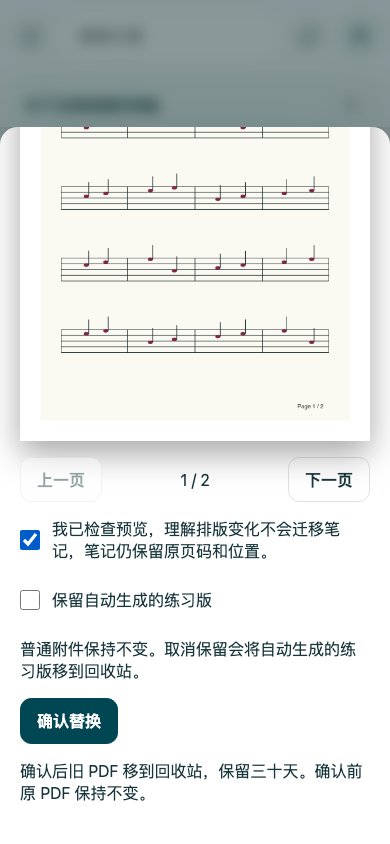
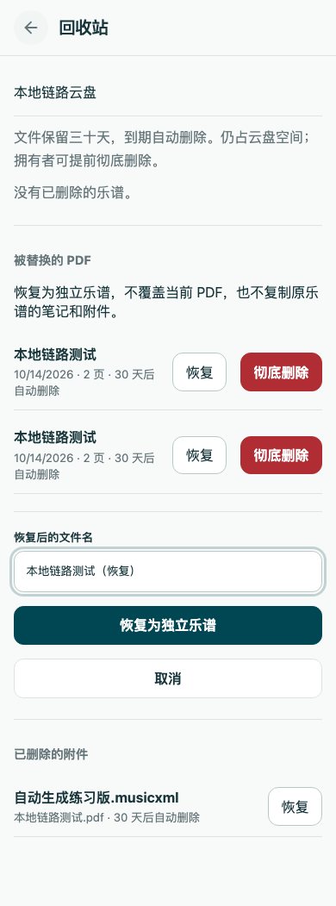

# PDF 替换与自动生成练习版验证

对应 Issue #428。隔离 worktree 从 `925a1a0` 开始，已重基到 `77d61bf`（XML 播放器 PR #427）；最终运行时构建身份 `6c60213aff6b174953eb5af2e39d3dc983dc5d73`。后续提交仅补充本证据、明确迁移文案与浏览器准备状态断言，不修改产品行为。

本地使用 Node 24.21.0，所有 Worker/D1/R2 资料都是隔离的合成测试数据，未连接生产库。未执行部署或生产迁移。

## 验证

- lint、TypeScript 与 production build 通过，PWA 预缓存未超预算。
- `npm run test:unit`：126/126；Worker unit：8/8；`npm run test:ci`：21/21。
- `npx vitest run --config vitest.client.config.ts --maxWorkers=2`：112 文件、995/995。
- `npx vitest run --config vitest.worker.config.ts --maxWorkers=1`：14 文件、146/146。
- 重基后的 PDF 弹窗、回收站、播放偏好相关客户端检查：37/37；谱面与附件 Worker 检查：36/36。
- `npm run test:migrations`：存量对象、配额、笔记、层、附件、删除队列保持不变；旧 PDF 使用原到期时间进入回收站；既有附件来源为用户上传。原有认证迁移检查继续通过。
- `browser-tests/pdf-replacement-trash.test.mjs`：Chromium/WebKit 2/2，实际上传、默认保留、取消保留、普通 XML 不变、旧 PDF 独立恢复、新旧谱都可见。
- 现有 `attachments-smoke`：2/2；`musicxml-playback` 与 `playback-ux`：4/4；`access-smoke` 与 `free-trial-smoke`：3/3。覆盖文件替换、不可恢复的到期文件、免费云盘清理，以及新版 XML 播放与原 PDF 交接。

首次同时运行全部客户端、Worker、迁移与浏览器检查时，客户端和 Worker 出现测试等待超时；降低并发并分别重跑完整套件后全部通过，没有改测试超时或加入全局重试。新浏览器用例先修正去掉 `.pdf` 的菜单名称，再明确等待上传输入启用及真实 PDF 画布绘制完成：WebKit 在预览未完成时滚动点击确认框可能没有改变其状态，准备状态补齐后两引擎通过。

Worker 回归包含候选取消与旧客户端回滚兼容、并发恢复及响应丢失重试、恢复后再次替换/再次恢复、UUID 共享层可读取、到期/彻底删除不影响当前 PDF、生成 XML 单一位置与来源隔离、修订冲突、移除后不擅自补回、拥有者维护发布边界。Beta 文件可解析不代表识谱音符正确，真实谱面仍须另行校对。

## Standards

无可执行问题。规范审查确认迁移为增量、保留存量数据和期限、保留旧接口；恢复不复制笔记或附件，生成文件不覆盖用户文件。增量审查确认恢复成功后的刷新失败提示和移动布局保持原生命周期边界。

## Spec

无可执行问题。Issue #428 的替换、回收、恢复、权限、容量、生成 XML 独立维护和保留选择均已覆盖；重基到新版播放器后仍兼容。没有接入自动识谱、额度调度或新凭证。

审查结论：Standards 0 项、Spec 0 项；两轴均无阻止提交的问题。

## 移动布局

人工查看以下合成测试截图，确认回收站按钮文字横排、恢复名称与操作可见；替换窗口可滚动到保留选项和确认操作。截图不是物理 iPad／Android 设备验收。

## 公开体验 smoke 边界复核

首轮 PR CI `38574958028`（source head `c6a18ea`、merge artifact `c5763b3`）的新 PDF 流程在 Chromium/WebKit 均通过；失败分片的实际失败点是既有 `preview-notes-smoke`：Chromium 从 XML 返回 PDF 后未唤出编辑控件，WebKit 在编辑与文档切换期间记录原 PDF／附件请求取消的 Fetch API 页面错误。本地使用相同 Node 24 与当前 SHA 构建，原用例复现 WebKit 错误。

该用例此前仅等待视图选项值为 XML，就切回 PDF 并立即点击。播放准备提示退出会改变底栏与阅读视口高度；阅读器按几何修订取消旧的延迟 tap 是已有且受测试保护的行为。fixture 现明确等待播放器可播放、PDF 阅读器退出隐藏状态后再执行原点击，并在进入编辑／刷新前等待阅读器附件入口已完成真实元数据读取，避免 fixture 紧接着卸载入口造成 WebKit 请求取消。整页 networkidle 探索未解决这个竞态，最终未采用。所有本机笔记持久化、云端层只读、没有云端写入与没有页面错误的断言保持原样；没有过滤错误、增加重试或修改产品权限和手势。

修复后原公开体验用例 Chromium/WebKit 2/2 通过，明确等待真实可播放附件角标而不是推测网络静止；失败的 smoke 分片继续按原命令完整复核。
