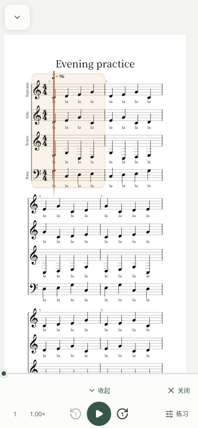
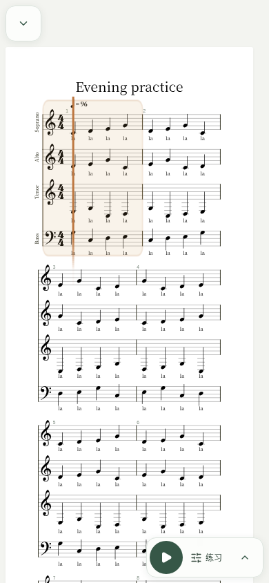
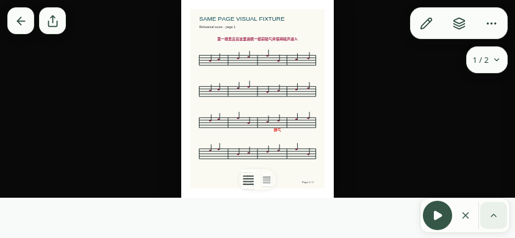

# 播放器最终界面与验证

MP3 边听边看沿用普通 PDF 阅读器的手势、工具和笔记编辑，不显示附件名或播放器顶栏；XML 看谱工具和播放栏独立收展，顶部收起只留向下箭头，对照字号随顶部收展。展开时收起入口显示“收起”，底栏关闭入口显示“关闭”；收起后恢复入口仅显示箭头，不增加文字。两种播放器的关闭入口均在底栏展开状态的右侧，收起入口在上沿中央；收起不暂停，关闭停止声音并返回所属 PDF。音频使用设备音量，XML 声部音量、静音、独奏和关注保留。

## 真实截图条件

修改前：干净 main `a7d7a7a` 的生产构建。最终截图：本 PR 最终运行时代码的本地生产构建，无头 Chromium，触控条件、中文 locale，390×844 竖屏及 844×390 横屏 CSS px。使用合成 PDF、SATB MusicXML、仓库 `practice-tone.mp3` 和隔离 mock API。图片是完整运行截图，无拼接、像素修改或生成式美化；未访问用户谱面或生产数据。

这是浏览器模拟，不是 iPhone/Android、真实系统工具栏、刘海或已安装 PWA 的验收。安全区由 CSS 注入模拟；键盘按键是浏览器自动化输入，未模拟手机系统虚拟键盘。

## 当前界面

| 场景 | 截图 |
| --- | --- |
| XML：全部展开 |  |
| XML：上收下展 |  |
| XML：全部收起 |  |
| XML：横屏对照，上展下收 |  |
| XML：横屏对照，全部收起 |  |
| MP3：PDF 阅读 |  |
| MP3：点中间呼出原阅读工具 |  |
| MP3：笔记编辑 |  |
| MP3：横屏音频栏收起 |  |
| MP3：关闭音频后 |  |

## 与 main 对照

| 场景 | main | 最终方案 |
| --- | --- | --- |
| XML 竖屏收起 |  |  |
| XML 对照横屏收起 |  |  |
| MP3 竖屏 |  |  |
| MP3 横屏收起 |  |  |

MP3 竖屏对比展示的是“旧设置面板”与“移除设置后的阅读界面”，并非同一个面板的换肤。

## 验证范围

- `practice-focus` 复用既有套件检查 Chromium/WebKit、320px、横竖屏、模拟安全区、独立收展、对照字号、播放与跟随、全屏请求/拒绝和浏览器退出时的按钮节点/焦点连续性；音频阶段检查同一媒体实例、普通阅读工具、图层面板、编辑工具避让、收展键盘操作及关闭释放。
- 真实本地 Worker/D1/R2 的 `practice-unified-controls` 和 `practice-compare` 双引擎 4/4 通过。原有关闭调用统一走“必要时展开 → 关闭”的测试辅助函数，保留播放、持久化与安全区检查，布局断言对应最终的操作行和播放行；未增加重试或放宽超时。
- 完整客户端 167 个文件、1451/1451 通过（含 reader-page 和 use-practice-focus 定向检查 48/48）；最终文字入口复用既有浏览器套件检查，practice-focus 双引擎 2/2、受影响播放与音频冒烟双引擎 6/6、focus/clearance hooks 9/9 通过；生产构建、类型及 lint 通过。
- 自审与独立只读 review 检查了下滑离开、更新验证脚本、加载/失败退出、对照字号及焦点。底部收展保留同一个按钮节点，避免全屏退出自动恢复时丢失焦点；关闭后把焦点交回阅读器。

UI mock 套件继续使用 `serviceWorkers: 'block'`，避免 Service Worker 绕过 page.route。此前同镜像 main/head 对照已证明隔离缺口，诊断见 [原失败 Actions](https://github.com/clydian/same-page/actions/runs/43656576559/job/132636544641)。真实 PWA 生命周期仍由既有独立套件覆盖，本次没有在产品中禁用 worker。

未做 VoiceOver/TalkBack、手机真机或已安装 PWA 验收；没有修改数据协议、权限、附件内容、manifest 或发布通道，没有合并或部署。
