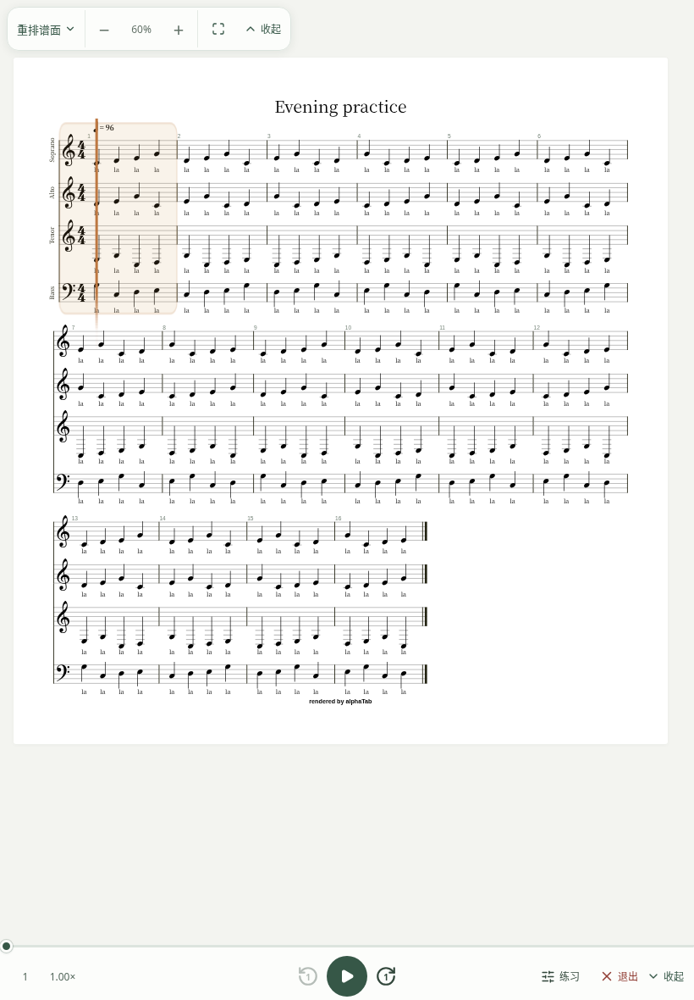
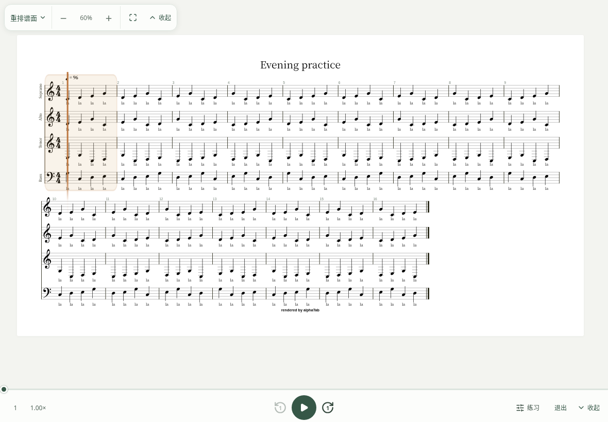
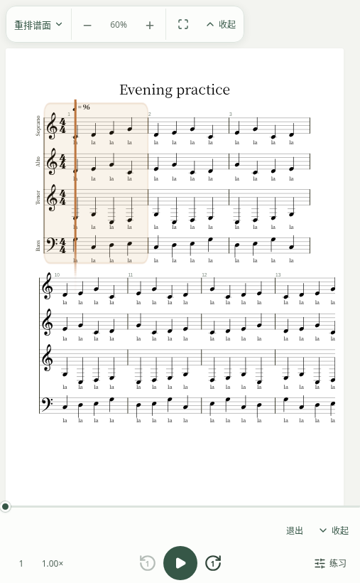
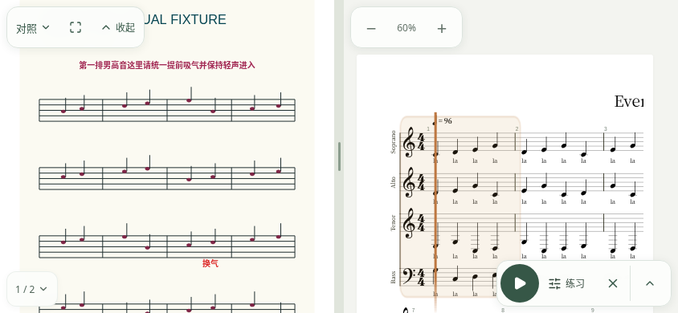
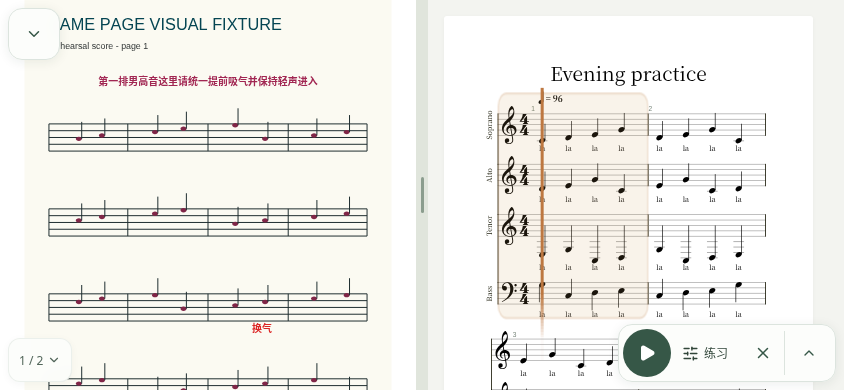
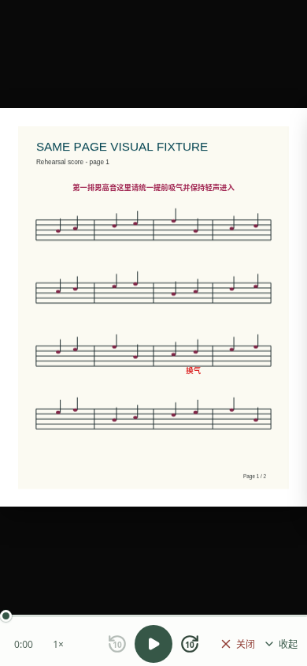
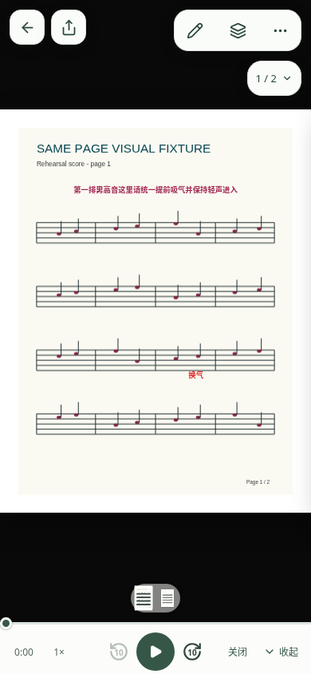
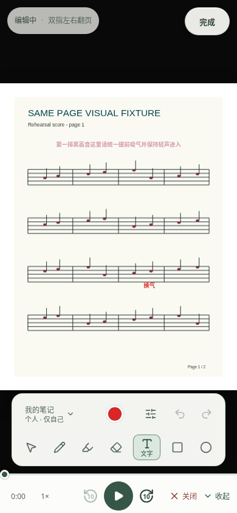
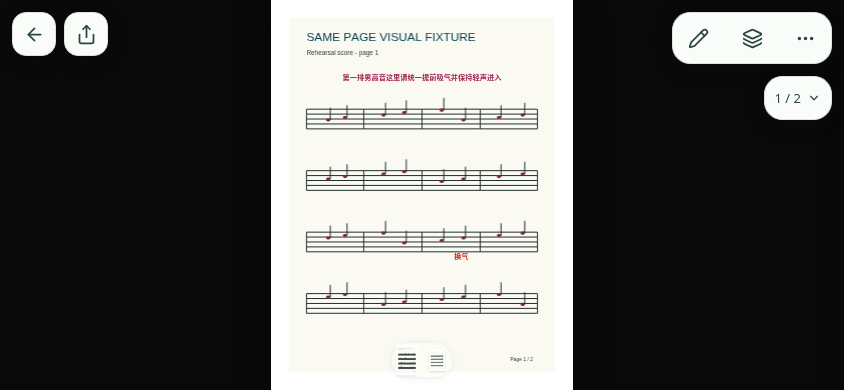
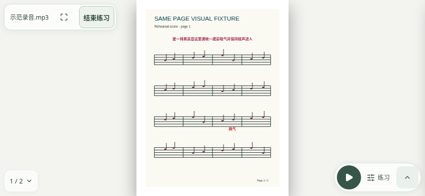

# 播放器最终界面与验证

MP3 边听边看沿用普通 PDF 阅读器的手势、工具和笔记编辑，不显示附件名或播放器顶栏。XML 顶部与底部独立收展，对照字号随顶部收展。展开时显示“收起”，XML 离开入口为“退出”，音频为“关闭”；收起后仅显示图标，退出/关闭始终可用，收展始终在最右。XML 窄屏保留两排，容器可用宽度达到 600px 时合为一排；MP3 达到 380px 时利用右侧空位合为一排，空间不足退回两排。收起不暂停，退出/关闭停止声音并保留所属 PDF。MP3 使用设备音量，XML 各声部控制保留。

## 真实截图条件

修改前：干净 main `a7d7a7a` 的生产构建。最终截图：本 PR 最终运行时代码的本地生产构建，无头 Chromium，触控条件、中文 locale，390×844 竖屏及 844×390 横屏，另有 iPad 尺寸 820×1180、1180×820 和 507×820 分屏 CSS px。使用合成 PDF、SATB MusicXML、仓库 `practice-tone.mp3` 和隔离 mock API。图片是完整运行截图，无拼接、像素修改或生成式美化；未访问用户谱面或生产数据。

这是浏览器模拟，不是 iPhone/Android、真实系统工具栏、刘海或已安装 PWA 的验收。安全区由 CSS 注入模拟；键盘按键是浏览器自动化输入，未模拟手机系统虚拟键盘。

## 当前界面

| 场景 | 截图 |
| --- | --- |
| XML：全部展开 |  |
| XML：iPad 竖屏，同排 |  |
| XML：iPad 横屏，同排 |  |
| XML：iPad 窄分屏，两排 |  |
| XML：上收下展 |  |
| XML：全部收起 |  |
| XML：横屏对照，上展下收 |  |
| XML：横屏对照，全部收起 |  |
| MP3：PDF 阅读 |  |
| MP3：点中间呼出原阅读工具 |  |
| MP3：笔记编辑 |  |
| MP3：横屏音频栏收起 |  |
| MP3：关闭音频后 |  |

## 与 main 对照

| 场景 | main | 最终方案 |
| --- | --- | --- |
| XML 竖屏收起 |  |  |
| XML 对照横屏收起 |  |  |
| MP3 竖屏 |  |  |
| MP3 横屏收起 |  |  |

MP3 竖屏对比展示的是“旧设置面板”与“移除设置后的阅读界面”，并非同一个面板的换肤。

## 验证范围

复用 `practice-focus` 套件检查 Chromium/WebKit、320px、手机横竖屏、iPad 宽屏/分屏、模拟安全区、收展/退出与键盘焦点、对照字号、播放跟随、全屏及拒绝反馈。音频阶段检查普通阅读工具、同一媒体实例、笔记编辑避让与收起状态直接关闭。更新既有断言，不增加重试或放宽超时。生产构建、类型、lint 和 focus/clearance hooks 亦在最终改动后验证；原有 playback-ux 双引擎 2/2 验证播放行垂直居中；具体结果见 evidence.json。

UI mock 套件使用 `serviceWorkers: 'block'`，避免 worker 绕过 page.route；产品 worker 没有改变。该隔离与附件触控菜单的 CI 修正已在前一 head `5a51425` 的主 CI 和扩展验证中通过，本次最终布局由新的 CI 再验证。

截图和 CSS 安全区均为浏览器模拟，不代表 iPad 真机、VoiceOver/TalkBack、系统虚拟键盘或已安装 PWA 验收。没有合并、部署或推进稳定版。
