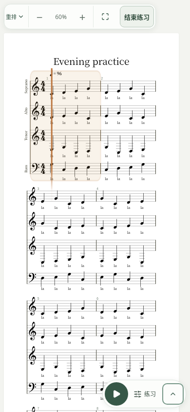
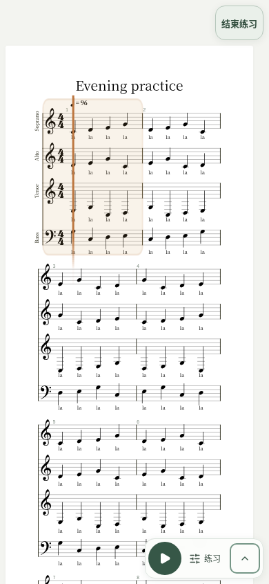
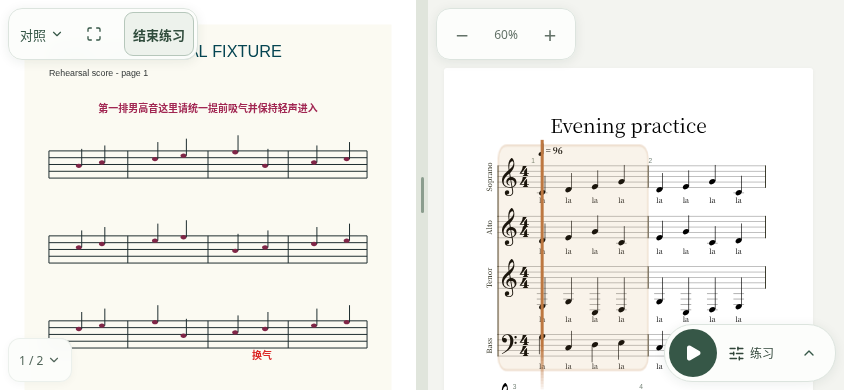
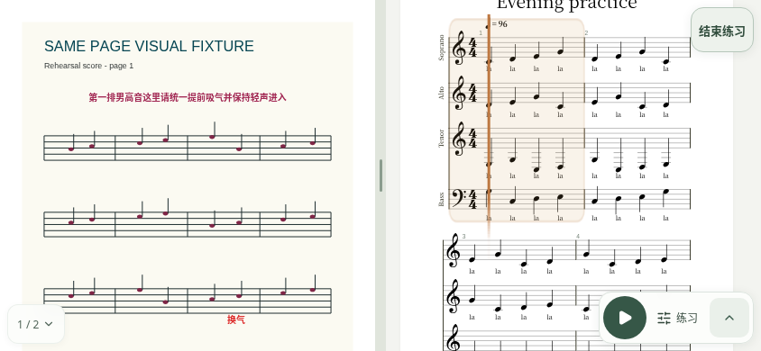
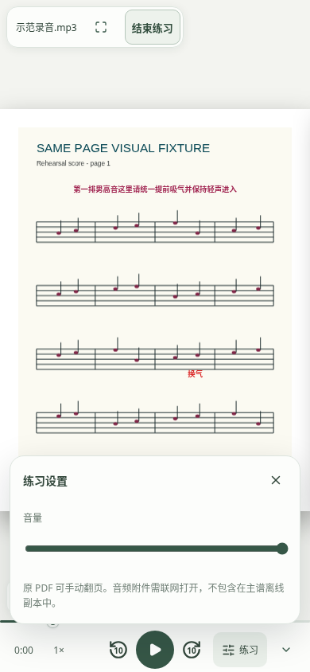
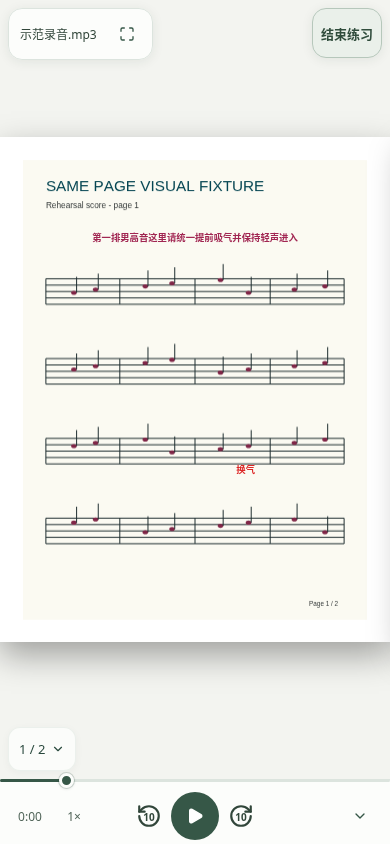
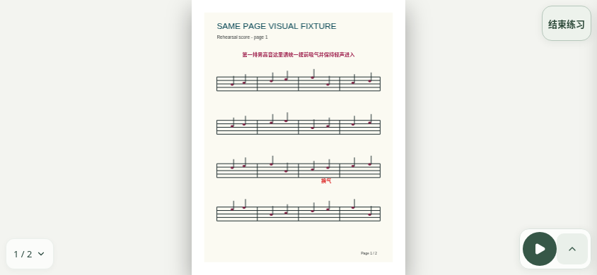

# 练习控制收展与音频简化证据

本次修改把 XML 的上下工具和对照字号统一到现有底部收展入口，收起后顶部仅留结束；音频移除总音量及没有内容可调的设置入口。结束按钮固定在右上安全区，上下浮动工具使用相同圆角、表面与边框语言。

代价是上下控制不再独立收展；用户仍可在收起时播放/暂停、打开 XML 练习设置，且可由底部唯一收展按钮恢复视图、字号、速度、进度与全屏/专注退出。没有增加计时或谱面点击自动隐藏。

## 截图条件

修改前为 `a7d7a7a` main 的干净生产构建，修改后为基于相同 main、带本 PR 运行时代码的本地生产构建。图片均由实际运行界面原样截取，没有拼接或修改像素。视口：竖屏 390×844、横屏 844×390 CSS px；无头 Chromium、触控条件、中文 locale。合成 PDF / 四声部 MusicXML 与仓库 `practice-tone.mp3`，截图接口采用隔离的本地 mock；没有访问用户谱面或生产云盘。

这些是浏览器模拟，不是手机真机、系统状态栏、真实刘海或已安装 PWA 截图。安全区测试另使用 CSS / CDP 注入；不把模拟器通过当作 iOS/Android 验收。

## 前后对比

相同尺寸、相同操作状态。MP3 设置对比的“后”明确展示已移除入口的看谱界面，不伪造一个不存在的面板。

| 场景 | 修改前 | 修改后 |
| --- | --- | --- |
| XML：竖屏收起 |  |  |
| 对照：横屏收起 |  |  |
| MP3：看谱设置 |  |  |
| MP3：横屏收起 |  |  |

## 验证与审查

- `npm run lint`、`npm run typecheck`、`SAME_PAGE_RELEASE_CHANNELS=1 npm run build` 通过；`npm run test:ci` 的 31 项通过。
- 完整客户端：167 个测试文件、1450 项通过。focus/clearance 的 8 项 hook 测试通过。
- 复用并更新 `visual-report/practice-focus.test.mjs`，覆盖横竖屏初始状态、旋转保留、320px、模拟安全区、上下统一恢复、对照字号隐藏、键盘 Enter/Space 与焦点、全屏/专注回退、MP3 连续播放与结束释放；没有为每种组合新增一套重复测试。
- 真实本地 Worker/D1/R2 的 `practice-reader-layout`、`practice-panel-safe-area`、`practice-unified-controls`、`practice-compare` 通过。另补验 `musicxml-startup / hidden-notation` 和 `preview-notes-smoke / signed-in-musicxml`，保持准备中切视图、编辑后进入练习及体验笔记隔离路径。
- 自审和独立只读 review 完成。修正了两个横屏调用测试需要先展开的问题、对照几何测试误把透明头部空白当实体障碍的问题；音频 focus hook 保留在看谱子组件，维持离开看谱时原有的全屏所有权生命周期。
- 首轮真实后端检查中，对照旧几何断言失败，另两个场景缺默认 Chromium；修正断言、安装浏览器后，三项后续检查通过。首次记录未被当成成功。

WebKit 虽已下载，但当前环境缺少 GTK4 等动态库，未宣称 WebKit 通过；也未执行手机真机、VoiceOver/TalkBack 或已安装 PWA 验收。没有改存储、权限、原音频/XML、manifest、设备设置或发布通道，没有合并、部署或推进稳定版。

具体条件与检查状态见 [evidence.json](evidence.json)。
