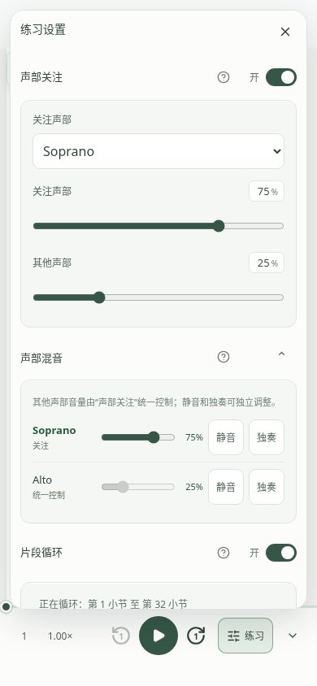
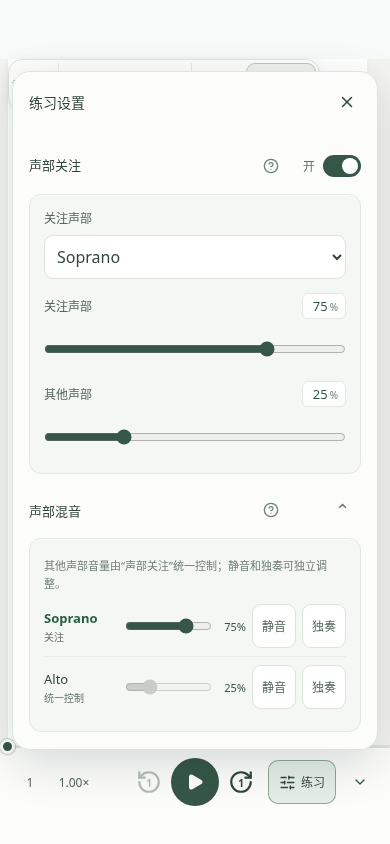
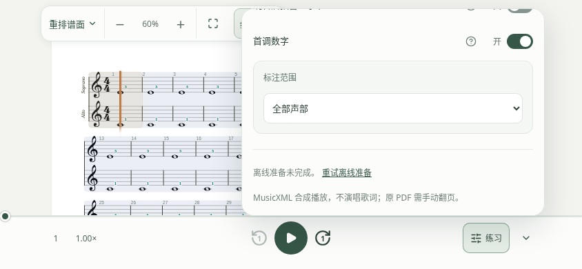
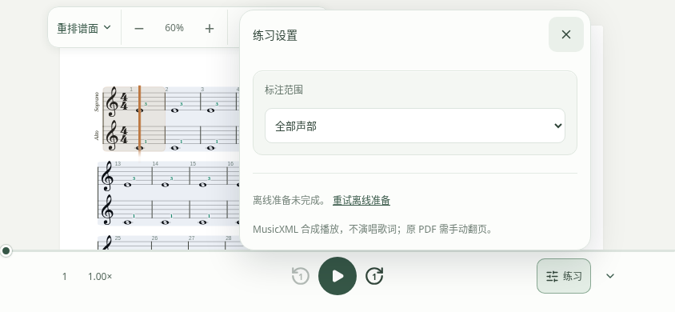
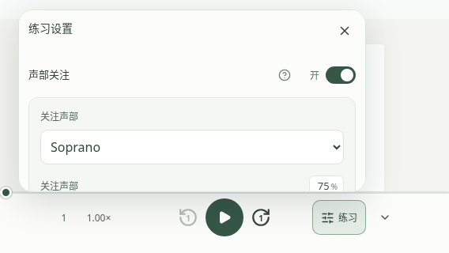
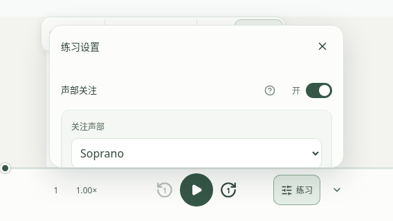

# 练习设置安全区与内部滚动验证

2026-11-14。修复前基线为 `3ddac9ea505c736ad6b967b2cbca2fcea24aa597`。

练习设置、速度和定位面板现在将定位边界限制为 CSS 安全区与 visual viewport 的交集。现有 12px 边缘留白和 10px 触发器间距保留，自有宽高限制与 React Aria 使用同一边界。标题和 44×44px 关闭按钮在滚动容器外，只有内容区滚动；循环范围拖动仍保留原有透明预览行为。

## 截图范围

下列前后截图都来自完整本地应用、真实隔离 Worker/D1/R2 和仓库原创双声部 MusicXML fixture，使用同一 Playwright Chromium 156.0.8078.4。打开练习设置，展开声部混音，并启用声部关注、片段循环和首调数字。修复前在独立的基线副本运行相同操作；修复后由新增浏览器回归直接生成截图。

安全区通过 Chromium CDP 的 `Emulation.setSafeAreaInsetsOverride` 和对应的 `--safe-*` 变量注入。没有画入假的系统状态栏；图片中的顶部空白不是真实 OS 截图。浏览器运行于普通页面，禁止 Service Worker，未安装 PWA。这些结果证明应用的布局与点击命中行为，不能证明 iOS/Android 系统状态栏拦截、刘海数值上报或真实触摸滚动表现。

| 场景 | 修复前 | 修复后 |
| --- | --- | --- |
| 390×844 竖屏：顶部 59px、底部 34px。弹窗顶部由 12px 移到 71px。 |  |  |
| 844×390 横屏：左右各 59px、底部 21px，滚动到最后一项。修复前标题和关闭叉滚出视口，修复后保持在头部。 |  |  |
| 568×320 窄横屏：顶部 24px、左右各 59px、底部 21px。四边都留在安全区内。 |  |  |

坐标、浏览器版本与源码摘要见 [evidence.json](evidence.json)。完整截图和两个引擎的原始坐标由测试写入 `artifacts/verification/practice-panel-safe-area/<engine>/`。

## 自动化验证

新增 `browser-tests/practice-panel-safe-area.test.mjs` 同时运行 Chromium 和 WebKit，验证：

- 长设置内容展开后，弹窗四边、完整关闭点击区域及 DOM 命中位于安全区内。
- 弹窗保持打开时改变横竖屏、安全区及桌面尺寸；零安全区桌面保持可用。
- 最后一项可以滚动到可见，标题和关闭按钮坐标不变，外层弹窗不滚动，底部也能点击关闭。
- 速度、定位面板共用边界；Escape 和关闭后恢复触发器焦点；底栏收起时仍能打开和关闭设置。
- 没有页面错误，包括 ResizeObserver 错误。

将相同新增回归放到修复前的独立基线，Chromium 在首个 59px 顶部安全区断言失败；不是因缺少新增内容容器而失败。

本地通过：lint、生产构建（包含类型与预缓存校验）、播放器客户端 20 个文件／142 项测试；新增安全区回归与既有循环预览回归均在 Chromium/WebKit 通过；既有 `playback-ux`、`practice-unified-controls` 在 Chromium 通过。

WebKit 27.2 的缺失系统库仅解包到 `/tmp` 中的 Playwright 安装，不修改系统。其宿主库预检不能找到该临时目录，运行时使用 `PLAYWRIGHT_SKIP_VALIDATE_HOST_REQUIREMENTS=1`；实际浏览器启动、渲染和测试断言正常执行，测试没有增加 retries 或放宽断言。CI 使用正常浏览器依赖安装，不需要此环境设置。

复验命令（先构建，不要与浏览器测试同时重建产物）：

```sh
SAME_PAGE_RELEASE_CHANNELS=1 npm run build
node --test browser-tests/practice-panel-safe-area.test.mjs browser-tests/practice-loop.test.mjs
node --test --test-name-pattern=chromium browser-tests/playback-ux.test.mjs browser-tests/practice-unified-controls.test.mjs
npm run test:client -- --reporter=dot src/client/playback
npm run lint
```

仍需人工验证 iPhone/iPad Safari、主屏幕安装 PWA 与 Android 浏览器/PWA，覆盖真实状态栏、横竖屏切换、地址栏变化及原生触摸滚动。本 PR 不合并、不发布；稳定版暂停更新保持不变。
