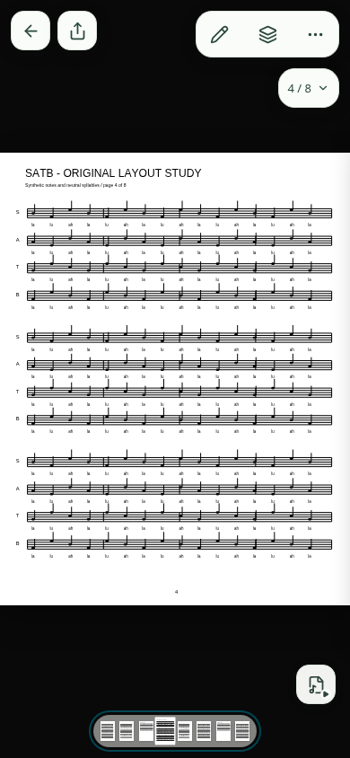
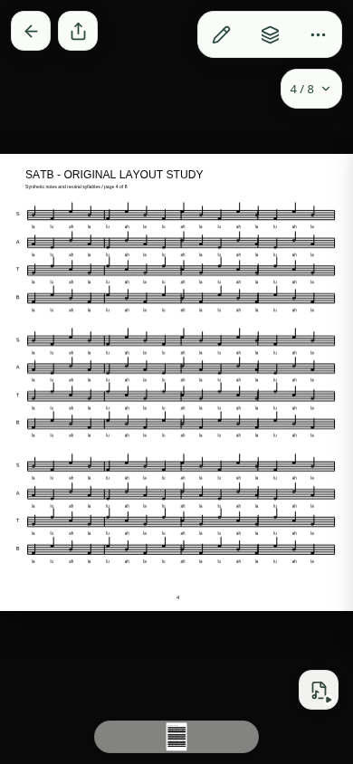
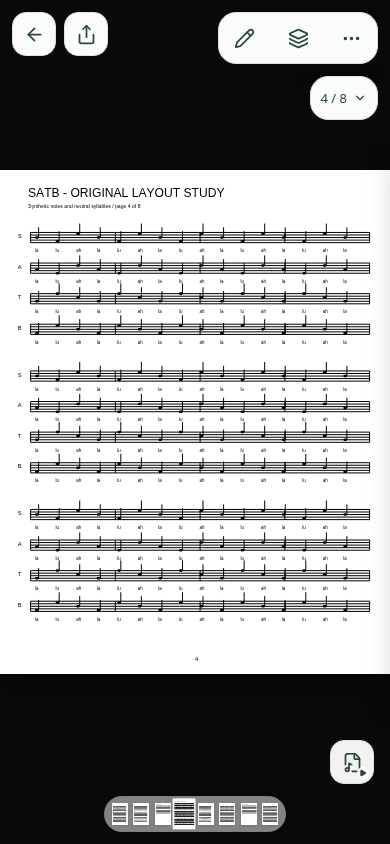

# XML 退出后的 PDF 缩略图恢复

## 基线和复现

2026-11-15，最新 main `a6d45e99404519e6c37b8920f987a77304709caa`。
PR #660 已于 08:47:11 UTC 合并，main 正是它的 merge commit；本次直接验证合并后的实际实现，无需另改该 PR。

使用实际客户端生产构建、真实 PDF.js 和 XML 播放器；API 为隔离 fixture，八页合成谱面，不访问生产或用户私人文件。
Chromium 390×844、触控模拟、reduced motion；桌面浏览器仿真不是 iPad/iPhone 真机验收。

1. 打开八页 PDF，显示工具，用缩略条停到第 4 页。
2. 打开“练习谱”→“声部练习版.musicxml”，等待真实重排谱面和可播放状态。
3. 点击“退出”。PDF 仍显示第 4/8 页，缩略条宽度 180px，缩略图却只剩 1 个。
4. 两次独立 main 生产构建运行均在 `Expected: 8 / Received: 1` 失败，未增加等待或重试。

复现命令：`PRACTICE_TEST_ENGINES=chromium node --test visual-report/reader-practice-exit.test.mjs`。
保留的 [main 失败输出](main-repro.txt)、[测量记录](main-states.json) 来自修复前生产构建。
最终测试增加了视图切换和生命周期断言；第一轮直接退出仍首先捕获原故障。

| 进入前 | main 退出后 | 修复后反复退出 |
| --- | --- | --- |
|  |  |  |

## 根因和最小修法

`PageNavigatorPanel` 在 XML 练习时保留，但 `compact` 移除内部缩略条 `<nav>`。
`useElementSize(panelRef)` 的 effect 只依赖稳定的 ref 对象，仍观察被移除的旧节点。
诊断记录：首次 `observe(180)`；进入 XML 后旧节点 `connected:false,width:0`；退出时新节点实际 180px，却没有新的 `observe`。
`count` 使用过期的 0 宽度计算，最少值为 1。总页数并未变成 1，也不是 PDF 只加载了一页。

这不是 DRY 问题：没有证据显示重复页数或重复播放器退出逻辑导致故障。
修复仅把缩略条的测量、高度避让和渲染移入本文件的 `PagePreviewStrip`，使观察器与被测节点共同挂载、卸载。
父级仍唯一持有拖动草稿和提交逻辑，沿用 120ms 定位、释放与失焦提交协议。
不增加通用 observer 抽象，不修改共享尺寸 hook、PDF/session、播放器退出行为、持久化或协议。

## 验证

- Chromium / WebKit 生产构建回归均通过（2/2）：两轮进入/退出；第二轮依次切换原始 PDF、对照、重排谱面，再收起控制后直接退出。
- 两轮均断言：8 张缩略图、4/8 页、slider max=8、当前 PDF sheet 第4页、同一 reader shell、PDF 请求次数不增加、页面总览8页、退出后焦点返回阅读器。
- [Chromium 输出](chromium-regression.txt)、[WebKit 输出](webkit-regression.txt) 与 [退出状态](fixed-states.json)。
- 原有30页整谱拖动跳页回归 Chromium / WebKit 均通过，见[输出](scrubber-regression.txt)。
- WebKit 首次启动缺运行库；将 Debian 包解压到临时目录并链接到下载的浏览器 runtime，未改系统或应用依赖。实际库加载和 WebKit 启动确认后，使用 `PLAYWRIGHT_SKIP_VALIDATE_HOST_REQUIREMENTS=1` 跳过仅检查系统路径的静态预检；真实浏览器运行、测试断言和超时均未绕过。
- 相关 reader preferences、navigation、presentation、practice focus 测试 27/27；lint、typecheck 与回归中的生产构建通过。
- 自审和独立只读 review 无阻塞项；独立 review 为静态审查，未另运行浏览器。
- Modern Web Guidance 查询 `observe element size`、`ResizeObserver conditional element`，无直接相关指南；未套用不相关 CSS/API 建议。

本证据使用 mock API 并阻止 Service Worker 接管，以保持请求隔离；不覆盖真实账号、本机旧 PWA、生产数据或实机 Safari/Pencil。未合并、部署或更新稳定版。
