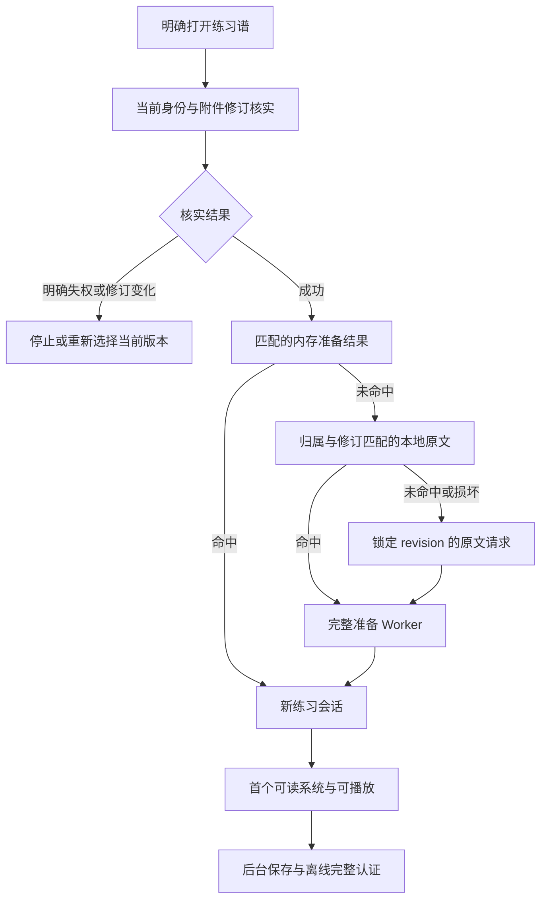

# MusicXML 打开性能优化方案

> 本文保留实施前的研究基准与决策依据；其中“当前”指该研究版本，不代表 #551 合入后的行为。产品实现和可执行回归见 [实施验证记录](../verification/2026-10-22-musicxml-startup.md)。原始诊断脚本留在研究工作区；本仓库仅收录不含谱文的摘要。

日期：2026-10-22。状态：**已完成代码核查、官方资料核对和独立原型实验；尚未实施产品修改或部署。**

## 推荐决策

优先做“更完整的不可变准备结果 + 每次独立的新练习会话”：把源文件相关的重复计算移入现有准备 Worker 并缓存，消除同会话重复 MIDI 生成，再补齐联网原文复用和公共资源准备调度。继续让每次明确打开从头开始，结束后释放当前谱和声音实例。

目前不推荐把整个 AlphaTabApi 隐藏保活，也不推荐首期持久化 vendor Score。前者把声音、DOM、受保护谱数据和用户练习状态绑在一起；后者已有可复现的音乐语义变化和更大的数据传输/内存成本。它们不是达到当前优化目标的必要条件。

方案分三批交付，测量先贯穿第一批：

| 批次 | 内容 | 主要受益场景 | 决策依据 |
|---|---|---|---|
| 第一批 | 归一化/小节标签完整准备、热缓存生命周期、同会话 MIDI 去重 | 同谱重开、A→B→A、长谱及练习较久后重开 | 有代码证据、CPU 分解、浏览器对照与 MIDI 保真结果 |
| 第二批 | 统一原文来源选择，联网复用已授权同修订本地 XML，合并在途 metadata，锁定原文 revision | 重新启动/内存缓存淘汰后，尤其网络慢时 | 当前在线路径未用持久原文；具体收益须在完整应用/真机上测 |
| 第三批 | 前台优先的后台离线准备、同任务校验复用、公共字节跨 build 复用；审计可减掉的字体资源 | 首次 XML、前端更新后的首次 XML、移动端存储/CPU 争用 | 公共包和重复审计路径已确认，用户实际占比未测 |

完成前三批后，用实体设备分段计时决定是否进入 parsed soundbank 复用、持久派生缓存或分段布局实验。不要提前把这些重构绑定为全部优化的前置条件。

## 用户等待应分成三个结果

1. **首个可读谱面系统**：第一行真实五线谱/音符已经显示，而不是只出现标题、SVG 空壳或 loading 消失。
2. **可播放**：MIDI、合成器和音色达到 session ready。
3. **首次点击到出声**：包括 AudioWorklet 模块获取/编译/实例化与音频恢复。当前 native13 在 `play()` 才创建 worklet，因此 player ready 不代表这段延迟为零。

离线可用是另一条后台结果，不能让“可以播放”等待完整离线审计，也不能因为正在播放就提前宣称离线可用。每个阶段用同一次 open generation 关联；并行阶段不能简单相加成总耗时。

用户报告 iPhone/iPad 已安装版与 Android 都慢。当前 Android APK 是同站点 TWA（`android/twa-manifest.json`、`android/generate.mjs`），浏览器安装版与它都使用网页引擎路径；这使共同处理路径成为合理优化对象，不构成已经测得两类实体设备根因占比的证据。

## 已完成的证据与实验

### 资源与代码身份

线上基准为 build `f7920e7331a614d3d97a8096b3cc83c3ee75b289` / `v26.10.22.1225`，player `0.1.19-samepage.12`、alphaTab `1.8.4-samepage.13`。使用线上 build/manifest 校验的生产 bundle、worker、音色和字体；相对本地 HEAD `9cfe46fa24bb039fd1fd0343a0ec385c0acb19e7`，播放器源码没有差异。根目录普通 `node_modules` 的 alphaTab 不匹配，因此独立模型实验使用已核实的 installed-pair13 release artifacts。

此前完整机制见 [首次诊断](2026-10-22-musicxml-startup-baseline.md)。本次专项材料：[缓存](2026-10-22-musicxml-cache-options.md)、[runtime/音色/布局](2026-10-22-musicxml-runtime-options.md)、[Worker/模型保真](2026-10-22-musicxml-worker-options.md)。

### 热开浏览器对照

在独立诊断副本中，仅将 ties/repeats 归一化与小节标签提取的结果预先准备并缓存；仍然每次新建 Score、播放器、音色与排版。未改业务代码、云端文件或真实用户状态。

每种方案 4 轮，第一轮作为预热剔除，余下 3 轮取中位；轮换执行顺序。XML 分别为 The Sun Never Says（5 声部、70 小节）和 Jesu, meine Freude（5 声部、441 小节）。

| 引擎/谱子 | 当前热开可播放 | 完整准备缓存命中后 | 当前首个 SVG | 完整准备缓存命中后 |
|---|---:|---:|---:|---:|
| Chromium，CPU 4 倍降速，70 小节 | 570 ms | 244 ms | 704 ms | 397 ms |
| Chromium，CPU 4 倍降速，441 小节 | 1790 ms | 889 ms | 2443 ms | 1582 ms |
| macOS WebKit，70 小节 | 402 ms | 193 ms | 674 ms | 319 ms |
| macOS WebKit，441 小节 | 1019 ms | 652 ms | 2185 ms | 1707 ms |

Chromium 长谱最长主线程任务的中位从约 1623 ms 降到 731 ms，说明已移除了有意义的 UI 阻塞，但仍有后续计算可优化。再去掉同栈第二次 MIDI 生成的组合原型，长谱可播放/首 SVG 中位约为 840/1470 ms；数据有系统/JIT 波动，不应把两项差值相加或承诺固定提升比例。

**限制**：这是资源已在本机、准备结果已存在的热会话实验，不含应用启动、鉴权、原文网络、Service Worker、IndexedDB、后台离线任务；不是手机或安装态实测。这里记录的是首个 SVG 代理值，正式验收必须改为首个真实可读系统。3 个有效样本只能支撑方向性判断，不能给出 p95。WebKit 当前不支持本实验使用的 longtask observer，原始报告该项的 0 不能解释为没有长任务。缓存未命中的首次打开仍需要完成同样的预处理，移到 Worker 优先改善响应性，不保证冷开总时间按相同比例下降。

原始材料：pipeline-results.json（研究工作区产物 `artifacts/diagnostics/musicxml-optimization-2026-10-22/pipeline-results.json`）、[summary](musicxml-startup-evidence/pipeline-summary.json)、构建原型（研究工作区产物 `artifacts/diagnostics/musicxml-optimization-2026-10-22/build-variants.mjs`）、测量脚本（研究工作区产物 `artifacts/diagnostics/musicxml-optimization-2026-10-22/measure-pipeline.mjs`）。原型为隔离实验，包含冗余中间数组和诊断标签提取，并非建议直接合入的产品实现。

### 音乐正确性与实际声音

- 保持原来的 direction→ties→repeat 顺序，只改变准备位置的对照，2 份真实谱 + 7 份 ties、offbeat wedge、gradual dynamics、hidden time、tremolo 控制样本的完整 MIDI 事件（含钢琴攻击修正）均一致。复现（研究工作区产物 `artifacts/diagnostics/musicxml-optimization-2026-10-22/validate-normalized.mjs`）、[结果](musicxml-startup-evidence/normalized-fidelity.json)。这不替代谱面视觉、全部语义和真机验收。
- 当前同次开谱 MIDI 生成 2–3 次；最小去同栈重复后为 1–2 次；统一 synth ready 路径后，两个引擎共 10 个场景稳定 1 次，ready 和 SVG 成功。
- 后一原型还在 Chromium/WebKit × 两真实谱共 4 场景经用户点击、实际 WebAudio analyser 得到非零波形并能暂停。不是仅断言按钮状态，也不等于耳听和手机音频中断恢复验收。[声音报告](musicxml-startup-evidence/runtime-ready-gated-audio.json)。

### 不应直接采用的完整 Score 缓存

完整 Score→JsonConverter→structured clone→Score 的原型确实减少了热开主线程工作，但保真检查失败：Sun 1358/1422、Jesu 7588/7694 个音符的力度改变。hydration 后补跑力度修正能恢复三份样本的 MIDI，但 Sun 仍有一处连音关系变化。完整 Score 的 JSON 表示约 2.54/13.52 MB，对比源 XML 0.51/2.53 MB；这只是序列化表示大小，不是 JS 堆峰值。

浏览器长谱模型传输/重建也有额外成本；不能只测 Worker 内 import 时间。官方支持 JsonConverter，但[明确不保证跨 alphaTab 版本兼容](https://docs.alphatab.net/docs/guides/lowlevel-apis)。浏览器的 [structured clone 不保留自定义原型链](https://developer.mozilla.org/en-US/docs/Web/API/Web_Workers_API/Structured_clone_algorithm)，也不能把活 Score 当可直接搬运的运行实例。

另一个问题是当前 alphaTab 公共入口在 Worker 中自动安装 renderer/synth 协议。整模型 Worker 要先有明确的纯 core 入口；屏蔽无关消息不是可靠修复。具体复现见 Worker 专项材料及 [score-roundtrip.json](musicxml-startup-evidence/score-roundtrip.json)。

## 第一批：完整准备与同会话去重

### 1.1 准备 Worker 回传可直接导入的输入

沿用现有小型 Worker，不加载声音或排版 runtime：

1. 校验原始 XML/MXL、解包。
2. 复用现有有序 XML 树收集原谱声明、速度、力度、文本、拍号可见性，并收集第一 part 的印刷小节标签。
3. 保持现有 direction timing→ties 修复→repeat ending 修复的顺序。
4. 回传最终 import-ready UTF-8 bytes、metadata、小节标签及 preparation format 标识。
5. 每次新会话直接 native import，继续按原顺序做导入后音乐修正和会话默认设置。

prepared 只保留最终一份 XML byte array，不同时保留 direction/ties/repeats 的全部中间数组。原始 XML/MXL 仍作为独立原文保存，不修改上传文件。先不合并三套转换为一遍 AST 遍历；那是后续冷开优化，需要另验转换顺序和异常语义。

建议新增统一 `prepareMusicXmlForPlaybackBytes` 入口，保留导出的旧 direction helper 语义。`PreparedMusicXml` 可加 `importInputVersion` 和 `measureLabels`：已识别版本直接导入；没有版本的旧调用方走原来的归一化/DOMParser 回退；未知显式版本视为派生缓存不兼容，从原文重做。缓存算法键包含精确 player/native/预处理身份，避免将 native13 输入用于语义不同的新 native 补丁。

主线程不再为每次开谱重新 parse XML 提取标签。新编译结果总是包含标签数组；空数组和旧字段缺失要明确区分。具体接口见 Worker 专项材料末节。

### 1.2 活跃准备结果与闲置缓存分开管理

从写入时起固定 5 分钟到期，改成“会话持有 + 释放后闲置淘汰”：练习 20 分钟不应让结束后重开立即失去准备结果。

首期可以保留现有条目/字节限制作为起点，先改变失效时机；测量 metadata 和工作集后再调额度，不直接许诺缓存十首或保留一小时。未使用条目按容量、LRU 和闲置时间淘汰；大谱可以不进入闲置缓存。当前活跃 Score/renderer/synth 的工作集、生成新准备时的峰值和缓存保留量要分别计量，不能把原文+prepared bytes 的 32 MiB 下界当总内存上限。

缓存只保存不可变的准备结果。每次播放状态、速度、关注/独奏、循环仍重新初始化；owner/effective session、revision、撤权、退出及清理文件等失效/fence 继续生效。不可因为 lease 或迟到 Worker 回复使已失效的缓存重新出现。

### 1.3 每个未变化的 Score generation 只生成一份播放数据

先消除 `_internalRenderTracks` 与 `_onScoreLoaded` 同栈双调用，再统一 synth 晚到路径。正式做法应在受控 native 源码中区分：

- 当前 Score/settings generation 的播放数据是否已经生成；
- 当前 synth 是否已经载入这份 generation；
- 显式 `loadMidiForScore()` 或真正影响播放的变动是否要求重新生成。

生成数据包括 MIDI、tick lookup、tick shift、sync points、transposition、backing track 和钢琴修正，不是只缓存一个 `.mid`。晚到 synth 应载入当前有效结果，不能无条件再生成；销毁和换谱使旧回调失效。保留显式重建能力，不能用“同一个 Score 永不重建”的全局 guard。

生产修复不使用诊断脚本的 prototype monkey patch。native artifact/source 发布、调用方版本和缓存算法身份一同更新。首期不做跨会话 MIDI/tickCache 共享：旧 tickCache 引用旧 Score 的 MasterBar/Beat，新 Score 不能直接借用。

## 第二批：让联网打开用好本地 XML

建立一个来源选择入口，隐藏权限、缓存及回退复杂度：



网络错误/5xx 的离线 fallback 仍走现有已验证离线权限、附件目录、壳、完整公共包和原文校验；图中未画这条异常路径。401/403/404、修订不匹配或 schema 错误不能回退旧内容。

**关键拆分**：现有 `readOfflineMusicXml` 把字节读取与“可以离线使用”捆绑了。联网成功授权后，应从同归属同修订原文 store 读取并校验，不必先准备 PDF 或核验整包；真正离线打开继续保留当前完整门槛。不要直接把 `readOfflineMusicXml` 插入联网热路径。

- 同次开谱 metadata 合并在途 Promise，不长期缓存云端权限；focus 继续新鲜核实。
- 本地 Blob 读取/校验有界等待，失常存储不能阻断网络；来源一旦选择，迟到结果不能替换。预算由真机读取分位数决定。
- 原文网络请求带预期 `revision`，核对 `X-Attachment-Revision`。服务端已支持，无需新接口或数据库迁移。自动生成练习版可同附件身份更新内容，不能只按 URL/文件名假定不可变。当前 metadata→file 静态竞态还未做并发复现；该回归应随 resolver 完成。
- 读取结束和写事务继续核对 session/logout/denial/cleanup fences。存储损坏是 cache miss，不是云端失权，也不应让正常联网用户无法打开。
- 沿用当前 `{sha256} + Blob` 原文记录和 key；缺少新可选字段仍可读取。新版不能批量删除旧副本或升级数据库导致旧窗口被关闭。未成功存新修订前保留旧文件，但不把旧文件冒充当前修订。

## 第三批：公共依赖与后台准备

### 3.1 让离线准备服从前台

当前后台与 session 创建重叠，齐包成功路径仍会对整个公共包逐项审计三轮。真实手机上的 CPU/存储争用占比尚未知。

自动任务在首个可读系统和可播放之后开始；显式重试可以主动开始。按 tab/build 合并公共包任务，按 owner/session/attachment/revision 合并原文保存与离线认证；最后一个消费者退出或身份失效后正确取消/fence。

同一个准备任务可复用已捕获、已核验的 Response/bytes，避免立即重复读同一内容和算 SHA；未来重新从磁盘读到的副本仍要验证。最终离线就绪继续检查完整壳、依赖、原文和既有离线权限。不能用“过去显示过 ready”无限期跳过完整性检查。

避免只依赖移动端一定存在的 idle callback/内存压力事件。低并发、有取消、有限任务生命周期已经足以开始；不承诺关闭 app 后还会完成。

### 3.2 更新版本时复用相同公共字节

保留现有 build-specific URL、cache 和旧壳退休协议。新包缺资源时，先从旧公共包找SHA/size 与**目标 manifest** 完全匹配、MIME 符合目标资源类型允许列表的 Response，校验后复制到新 build 自己的地址；没有才下载。

这能避免小前端更新后重新下载完全相同的音色/字体，并减少新包准备成本；不会免除新 synth 解析音色，也不等于跨进程保留声音实例。当前 manifest 只有 URL/bytes/integrity，MIME 要由目标资源类型的允许列表独立判断；若未来增加 MIME 字段应保持可选兼容。先不引入全局 CAS/refcount，以免牵动旧 Service Worker、旧窗口和 GC。

### 3.3 收敛真实依赖清单，再考虑声音预取

线上完整公共包为 15 项、约 12.27 MB 原始字节，包括多个字体格式和 metadata；音色本身约 1.35 MB，AudioWorklet 约 2.37 MB。优先做实际依赖审计，不先裁剪 SoundFont presets；XML 里的伴奏可能用不同乐器，且 native 已只解码实际使用的样本。

仅作体积上界分析：如果目标支持矩阵能证明只需 WOFF2，字体清单可减少约 4.38 MB 原始字节，整个包约 7.89 MB。**这是候选，不是已经验证可安全删除**；需要核查 metadata、字体回退和离线行为。保留服务器旧路径与旧 build，先缩新 manifest，不破坏活跃旧客户端。

在用户明确开 XML 后，可试验较早获取 worklet 字节或 warmup；普通 PDF 阅读不创建声音硬件，也不全量预取所有谱。更早编译/建节点可能占前台 CPU，并触及 autoplay、取消和晚到声音问题，必须单独做首次点击至出声对照。可先验证纯文件预取，不能直接假定预取等于完成 AudioWorklet 初始化。

## 后续选项与暂缓原因

| 选项 | 再进入条件 | 本期暂缓原因 |
|---|---|---|
| parsed soundbank/PCM 缓存 | 真机音色解析/解码仍是显著等待 | 没有现成稳定的共享接口；需精确 bank/sample-rate/版本/内存与释放契约 |
| 每 tab 一个 synth/AudioContext 租用 | 避免 worker/context 重建有可重复的净收益 | 必须清除旧谱和通道状态、处理独占/中断/耳机切换；不能跨窗口或依赖后台进程常驻 |
| 版本化 normalized 派生结果持久化 | 进程回收后的冷开预处理仍明显慢 | 当前 ADR-0004 规定 prepared memory-only；要明确重开该决定。可以做可丢弃的增量记录与原文回退，无需删除用户数据，但不属首期默认 |
| 完整 Score Worker/缓存 | 先修复序列化力度/连音保真，且 clone/hydration/内存总收益成立 | 已复现语义变化、额外 Worker 初始化副作用和约五倍序列化体积 |
| 更早返回首屏系统的增量布局 | 前三批后真机 first-system 仍由全曲 layout 主导 | 当前已有 worker/lazy；仍全曲建系统/bounds，不能简单裁掉后半曲或开一个 lazy 开关 |
| 持久化 SVG/固定布局 | 有明确同 viewport 复用率和保真证据 | 屏宽、旋转、字号、字体、版本和 bounds 联动，失效与坐标风险高 |

[alphaTab 官方](https://docs.alphatab.net/docs/reference/types/coresettings/)已说明 worker/lazy rendering 能力；当前两者已启用。布局后续实验必须保留全曲播放 timeline、重复与循环，定位/首调坐标只在对应 bounds 有效时启用。不要把“仅显示前几小节”当作完整乐谱优化交付。

## 验收、度量与推出

第一批就增加轻量分段 marks：open intent、授权、raw ready、prepare、Score、MIDI、音色、首个可读系统、bounds、player ready、首次 play/worklet、后台 offline ready。记录 build、引擎/预处理版本、文件大小/声部/小节数量级、cache tier、结果和取消原因；不上传 XML 内容、歌词、文件名或用户身份来做性能分析。

场景矩阵至少包括：首次安装后第一份 XML、同谱立即重开、练习 20 分钟结束重开、A→B→A、刷新、系统回收后冷启动、原文已存但完整离线未就绪、弱网/稳定网/断网、更新前后、快切/取消、横竖屏/重排、后台恢复与音频路由变化。XML/MXL、短中长及复杂 repeats/ties/dynamics/lyrics 均要覆盖。

指标分别看 p50/p95、最大主线程任务、峰值与闲置内存、请求/传输字节和失败/取消。必须在真实 iPhone/iPad 已安装版与 Android 已安装版各建立基线；浏览器节流用于可重复回归，不替代设备结论。

建议把“代表性热开首个可读系统中位显著降低，长任务下降；冷开及普通阅读无可观察退化”作为首批目标。具体绝对 p95 门槛在同设备基线后确定；不要用本次 3 样本的代理时间编造设备 SLA。MIDI 单生成、语义一致、数据/权限隔离为硬门槛，不能以平均速度更快抵消。

推荐独立、可回退的 PR 单元：

1. 准备协议补全与精确保真/阶段计时；旧 payload 回退仍可运行。
2. native MIDI startup 去重；显式重建、钢琴修正和全部定位/循环语义保留。
3. 活跃/闲置准备缓存与来源 resolver；原文修订锁定、兼容旧记录、失权及迟到写回回归。
4. 后台审计调度与公共资源复制/清单收敛；旧壳旧窗口继续可用。

每个单元都以相同 final-head build 做真实内容对照。CI 之外，分别记录实体设备、发布与线上 build 身份；研究阶段未创建 PR、合并或部署；#551 的实施状态以实施验证记录为准。必要时在现有发布通道能力实际就绪且获授权后，小范围验收再提升稳定版；不要把尚未部署的通道设计当作已存在的生产能力。

只改变派生计算、缓存命中和内部调度；原 XML/PDF、笔记、附件身份及现有离线副本保留。前期无需后端 schema 变更或大规模数据迁移。新 prepared 不匹配即可从原文重建；新缓存功能可回退旧路径。未来若调整 prepared 持久化或结束后保留 synth，需分别更新 ADR-0004/ADR-0010 的相关决定。

## 研究阶段复现命令（原研究工作区）

```sh
# 原型构建仅写 artifacts/diagnostics 下的副本，消费已保存且核 hash 的线上资源。
node artifacts/diagnostics/musicxml-optimization-2026-10-22/build-variants.mjs
node artifacts/diagnostics/musicxml-optimization-2026-10-22/measure-pipeline.mjs
node artifacts/diagnostics/musicxml-optimization-2026-10-22/validate-normalized.mjs

# MIDI 次数及实际 WebAudio 输出验证，脚本内是诊断包装。
INSTRUMENT=1 REPORT_NAME=runtime-ready-gated.json node artifacts/diagnostics/musicxml-startup-2026-10-22/measure-runtime-ready-gated.mjs
INSTRUMENT=1 REPORT_NAME=runtime-ready-gated-audio.json node artifacts/diagnostics/musicxml-startup-2026-10-22/measure-runtime-audio.mjs
```

以上在原研究工作区运行，完整脚本和报告保留在各诊断目录，不是本检出的可执行回归命令。正式实施不得直接复制诊断版的字符串替换、prototype 包装或正则标签提取到产品。
