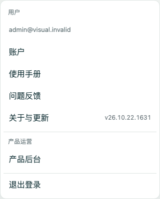
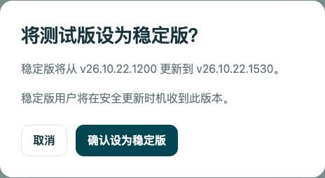

# #539 本地实现与验收记录

2026-10-22。分支 `codex/release-channels-539`，比较基线
`685a0eaf0b95a05f90ea38e927889033afce69ab`。仅本地工程实现与隔离测试；
没有部署、生产迁移、创建 bucket、修改生产指针或授权生产发布人员。

实现决策见 [ADR-0021](../adr/0021-release-channels.md)，首次启用步骤见
[发布 runbook](../operations/production-release.md)。默认构建和 runtime flag 均关闭通道，
桥接完成并另行授权前不显示选择器，也不在旧页面上查询通道 API。

## 产物与数据回切

`verify-release-storage.mjs` 逐字节读取两个探针，校验摘要后在 Chromium/WebKit
全新临时持久 profile 运行实际 SamePageDatabase 的
`stable → candidate → stable → candidate`。本地已用基线源码快照和当前源码构建
**不同的两个探针**通过回切，包含 Blob／快照、继续编辑、真实草稿与队列写入、
协议解析与 push/pull 合并、已尝试 opId、冲突及归属隔离。

本地快照验证不冒充线上当前 stable 产物验收。正式 uploader 必须从 R2 下载当前 stable
封存的原始探针，与候选原始探针运行同一矩阵；报告绑定双方 ID 和探针摘要，
私有封存对象和 D1 记录共同参与 beta 准入、stable 提升检查。存储契约不相等直接拒绝。
探针与报告不在公开前端清单内。

WebKit ephemeral context 的原生 Blob 首写错误已通过对照定位为运行模式限制：
全新临时 persistent context 的原生 IDB 和产品数据库 Blob 均通过。
此结论不替代真实 Safari/iOS 验收。

## 浏览器与服务端证据

- `verify-release-channels.mjs`：Chromium 151.0.7922.34 / WebKit 26.5 使用实际生产
  SW 模块，通过冷启动 stable、A/B 回切、忙碌窗口否决、过时候选拒绝、无窗口自动激活
  不取得错误显示许可；另通过 Cookie 回 stable 且稳定缓存缺失时的恢复、忙碌窗口阻止恢复、
  保存后再次重试成功。结果为 `artifacts/verification/release-channels.json`。
- `verify-shell-lifecycle.mjs`：Chromium 自动／手动 A/B/C、WebKit 手动 A/B/C，
  完整壳校验和真实配额不足恢复通过。
- `verify-shell-retention.mjs`：双引擎各二十次候选替换及二十次激活有界保留；草稿保留。
  Chromium 观察到真实 BFCache 恢复；WebKit 仅观察到普通返回，未声称其 BFCache 通过。
- `verify-update-diagnostics.mjs`：双引擎旧壳旁准备候选、旧壳绕过、失败重试、
  阻塞数据库诊断、草稿保留且不意外创建业务库通过。
- Worker 集成验证覆盖默认 stable、封存资源与缓存边界、未知 API、Cookie 权威、
  独立授权、精确 CAS、证明缺失拒绝、单次审计与幂等、撤销授权后拒绝，以及 R2 条件首写。
- Standards 与 Spec 独立复审发现的契约覆盖、原子回执、Cookie 过期、产物证明、
  发布浏览器环境与恢复页交接问题均已修复，复审未发现仍存的确定问题。

## 回归执行说明

`VITEST_MAX_WORKERS=4 npm run check` 中，CI 范围判断、lint、typecheck、
66 个 node 单测文件（295 项）、139 个客户端单测文件（1171 项）、
Worker unit（8 项）和 integration（181 项）通过；后续新增的 picker 关闭开关测试、
真实鉴权提升 endpoint 测试亦分别通过。最终配置的构建与迁移测试通过。

视觉全套初轮执行了 205 项，含本轮修复前的通道查询、预览身份头失败，以及导航超时／
配置重载干扰；因此该次 `check` 本身为失败，不能描述成一次全绿。
固定最终配置后，所有失败所在场景已分别重跑通过：practice-focus、reader-conflicts、
reader-presentation、reader-settlement 的双引擎 pinch，以及 uiux-return（WebKit 又单独重跑全部场景）。
未放宽业务断言或超时，也未删除失败用例。

默认构建的完整 smoke 通过 63 项；默认与启用通道构建的加载性能预算均通过。
`SAME_PAGE_RELEASE_CHANNELS=1 npm run build` 最终生成 128 个唯一壳资源，
6,921,215 bytes，小于 7 MiB 门槛。启用产物的代表性真实浏览器检查通过：
Chromium 离线重启／撤销权限、实际 D1/R2 内容与 IndexedDB 重启恢复、
WebKit API 中断新页面／撤销权限。WebKit 首轮有一次 SW ready 等待超时，
诊断复跑及未修改原用例的单独重跑均通过，未放宽断言。

CI 通道开关只作用于正式 build；dev 视觉与合成 PWA build 保持各自原来条件。
smoke/performance 仍下载并校验同一份正式 artifact。隔离 preview 自动在自己的
临时 D1/R2 目录准备同 SHA 的 bridge 控制元数据，前缀资源仍是原始 ASSETS 字节，
真实 SW 继续校验它们。这不是生产 R2 托管全链验收；正式发布桶和路由仍需受控上线验证。
通用视觉夹具明确响应对应构建身份的 release GET，不把新控制请求当作未知业务请求。
CI 范围判断 21 项与视觉夹具测试在补修后通过。

## 尚待受控上线验收

真实 iOS PWA、Android TWA 的启动／离线 Blob／回切／旧壳行为，以及生产 IAM、CDN、
原始 legacy 资源归档、首次 bridge 和当前线上 stable 原始产物矩阵，必须在另行授权的
发布过程中留证。它们不由本地 Chromium/WebKit 仿真替代。本 issue 在这部分完成前保持打开。

## 2026-10-22 复审后的精简完善（未部署）

本轮按当前不足二十名真实用户、快速迭代的阶段调整；沿用已有实际产物回切矩阵，新增验证仅
针对这次发现的回归，不重新建设发布系统或扩展测试矩阵。以下更新替代前文对全源码相等门槛
以及“复审无未解决发现”的阶段性结论。

- 兼容检查收窄为明确的业务 IndexedDB／共享同步表示边界与 Dexie、Zod 版本，不再因 UI、
  普通实现依赖或兼容 D1 migration 的源码变化拒绝 beta。旧宽清单中的相同边界可继续比较，
  不重写既有封存产物。schema／不兼容同步写入仍须经过兼容桥接。
- 已完整缓存、且具有同通道许可的当前壳，不因配额不足时的回执重写失败而丢失可用性；
  新壳或新通道仍需可靠提交首次许可。
- 离线冷启动按当前 build 的已许可回执显示测试版标识，不恢复 Cookie 或伪造在线通道确认。
- 增加受控 `stop-beta` 运维命令与 [停止分发流程](../operations/production-release.md#停止故障-beta-继续分发)：
  精确 CAS 将 beta 暂时指回当前 ready stable，保留 stable、业务数据及全部产物。

本轮验证：

- `npm run lint`、`npm run typecheck` 通过。
- 定向 Node 回归三文件共 10 项通过：兼容边界与旧宽清单、不可变产物和证明绑定、
  停止 beta 的原子 CAS／过时请求拒绝、许可配额与首次授权边界。
- 通道选择器与离线标识客户端回归共 3 项通过；修复前新增回归失败、修复后通过。
- 原隔离故障探针确认：仅拒绝回执写入时完整健康壳仍为 200，离线 beta 返回常驻标识。
- `npm run test:release-channels` 在 Chromium 151.0.7922.34 与 WebKit 26.5 通过：
  A/B 回切、忙碌窗口否决、稳定缓存丢失恢复、过时候选及自动激活边界。
- `SAME_PAGE_RELEASE_CHANNELS=1 npm run build` 通过；生成的存储清单只有 11 个边界文件，
  壳为 128 个唯一资源、6,921,329 bytes，仍低于 7 MiB。构建有既有 Vite／alphaTab 警告。

这次没有重跑完整视觉／smoke／线上产物矩阵；上述针对性验证不替代正式发布门禁。
没有执行部署、生产迁移、生产通道变更或生产资源创建。

## 2026-10-22 界面、后台入口与更新提醒复核（未部署）

在前述精简完善之后，本轮完成以下已确认的交互：

- “关于与更新”合并版本、通道和更新状态；区分所选通道与当前运行通道，保留错误及重试。
  同一已许可构建的在线通道确认可更新显示归属，不新增显示许可；beta 切回 stable 后不残留
  测试版标识。同通道普通升级继续使用“新版本已准备好／重新加载并更新”的文案。
- “我的 → 产品后台”只在服务端确认当前会话具有既有后台能力后显示；不硬编码邮箱、不依据
  云盘拥有权授权、不持久化后台权限。换用户的迟到响应不能留下入口，重新打开菜单重新核验。
  后台复用登录并提供“返回合谱”；提升前用现有确认框显示明确目标，继续保留 CAS 与幂等重试。
- 通道表格、提升按钮／确认和记录显示封存 `build.json` 中的原始版本号。服务端核对产物清单、
  字节摘要、大小与 build 身份；缺失旧元数据明确显示未记录，不按上传时间拼版本号。
  仅增加可选响应元数据，没有新增数据库迁移或改变 SHA 身份、晋级请求协议。
- 仅在前台、安静的云盘文件库，对明确由其他窗口暂缓的完整更新显示一次轻提示：持续约
  10 秒后出现，约 8 秒后收起，悬停／聚焦暂停收起，可关闭或进入关于页查看更新。
  按当前页面生命周期内的 waiting worker 去重，路由往返与自动重试不重复弹；阅读／播放／
  上传／输入／弹窗不触发，资源不完整、消息失败或未知超时不冒充其他窗口正在操作。
  提醒不持有更新锁、不触发或绕过安全交接。

Standards 与 Spec 两路独立复核都指出同一个同通道更新文案问题；已修正判断并添加稳定版
A → 稳定版 B 回归。两路其余检查无确定未解决问题，未因风格判断扩大重构。

已整合 main `f7920e7` 的 `@same-page/player` workspace 迁移。播放器匹配同时覆盖真实 workspace
和安装路径，保留 `/_releases/<SHA>/` 资源前缀；生命周期断言继续等待实际“关于合谱”页面，
没有回退 main 的播放器维护归属或放宽断言。

本轮整合后的定向验证：

- 干净 `npm ci`、lint、typecheck；客户端 8 文件 84 项、Node 3 文件 13 项、Worker 集成 9 项通过。
- 播放器资源原有两例补为根路径／发布前缀两组，4 项通过；CI 范围判断 22 项通过。
- Chromium 151.0.7922.34／WebKit 26.5 的真实 SW 通道回切、忙碌窗口否决、稳定缓存丢失恢复、
  过时候选与自动激活许可检查通过。

以下为本地真实页面渲染截图，使用示例 API 数据；更新提醒另用可控 waiting worker 模拟另一
窗口否决，验证提醒、关闭、进入关于页及返回后不重复显示。它们不是生产或手机实机证据。
390px 与 320px 发布页无横向溢出；提醒的文件库截图检查了 390px 布局。

整合后的真实 PWA 更新脚本（通道关闭的合成 A/B 场景）也通过：两引擎按需动画／静态离线
回退、WebKit 多窗口否决、自动重启更新及立即手动交接。首次误将该脚本与启用通道构建并行
启动，两者共用 `dist` 导致产物被互相清理并出现 ENOENT；改为串行重跑，没有修改业务逻辑、
增加超时或放宽断言。完整原生播放器回归、全量视觉／smoke 未在本轮重复执行。

最后串行执行的 `SAME_PAGE_RELEASE_CHANNELS=1 npm run build` 通过，壳为 128 个唯一资源、
6,933,848 bytes，低于 7 MiB。直接检查最终 `build.json.scripts`、播放器 manifest 全部条目和
已编译 JS 的字体／音色 URL，均保留同一 `/_releases/<SHA>/` 前缀；workspace 路径迁移没有
退回根路径。构建仍有既有 Vite／alphaTab 警告。PR CI 的 deploy job 仅允许 main push，
提交本分支和创建 PR 不会触发该生产部署步骤。生产开关、资源、迁移、通道指针均未改变，
本卡的受控上线验收项继续保持未勾选。

## 2026-10-22 PR #540 CodeQL 告警复核

`29c686d` 的业务 CI（checks、backend、build、platform、visual 四组、smoke 三组、verify）
全部通过；唯一阻断为 `js/insufficient-password-hash`。SARIF 指向前端发布脚本读取
`CLOUDFLARE_API_TOKEN`，经 `deriveR2Credentials` 进入既有的 SHA-256 派生。
该实现也已存在于 main；输出仅在发布进程内作为 S3 `secretAccessKey` 使用。

[Cloudflare 官方协议](https://developers.cloudflare.com/r2/api/tokens/#get-s3-api-credentials-from-an-api-token)
明确要求 token ID 作为 Access Key ID、token value 的 SHA-256 作为 Secret Access Key。
CodeQL 的密码名称启发式包含 API token，未区分此协议用途，因此仅将
[告警 2](https://github.com/clydian/same-page/security/code-scanning/2) 按 `false positive` 处置并记录依据。
没有关闭规则或扫描，也没有通过改名、换哈希 API 隐藏数据流；保留原有认证协议。

干净安装 Android 脚本依赖后，`node --test android/publish.test.mjs` 的 14 项通过，
覆盖精确派生、user/account token 校验及失败行为。原 PR 的 CodeQL 门禁随处置恢复为通过。
此次源码仅补协议说明，不改变运行行为；没有新增重复测试、部署或生产变更。
