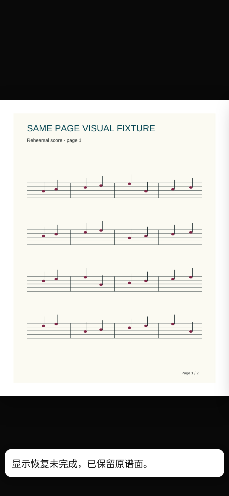
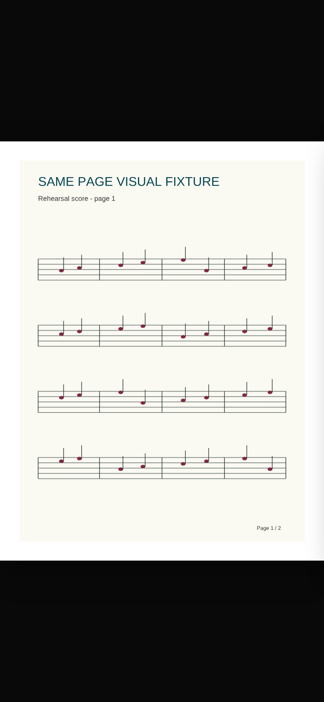
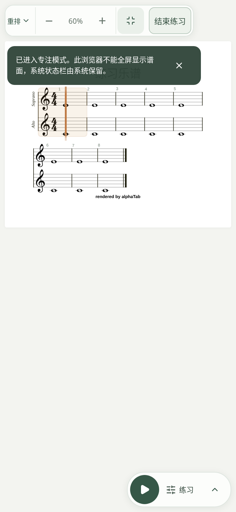
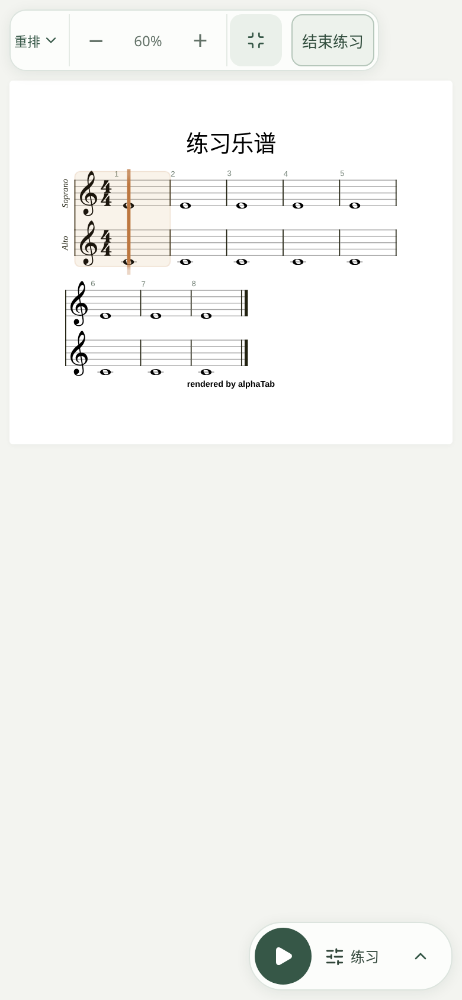
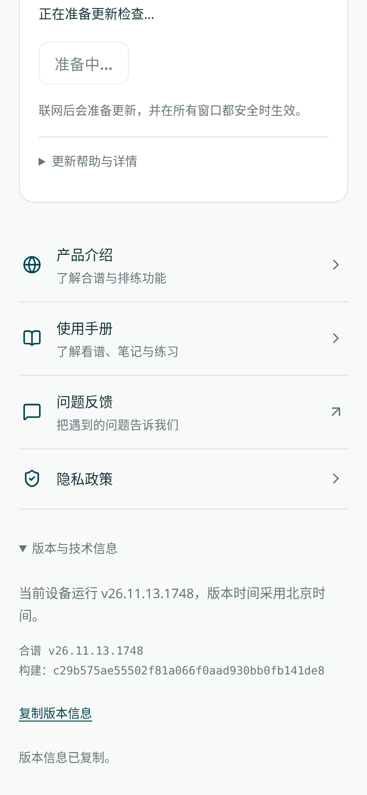
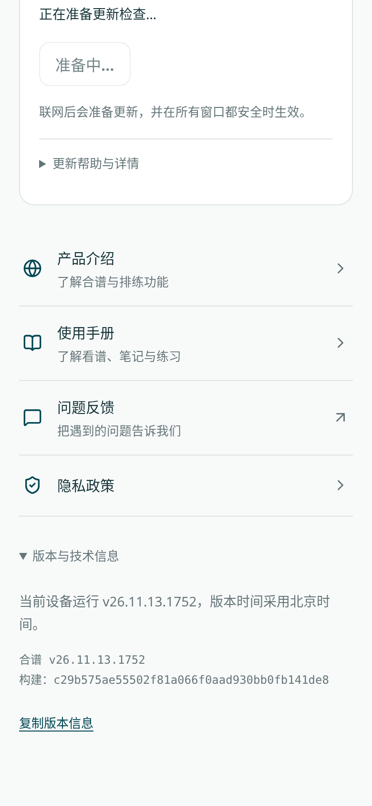

# 常驻提示清理与截图对比（2026-11-13）

审查清单中的待修项均已处理。短暂提示支持手动关闭，悬停或键盘焦点位于提示内时暂缓收起。
消息默认持续显示，只有调用方明确标记的成功或兼容说明才计时，避免误清除失败信息。

| 场景 | 修正后的行为 |
| --- | --- |
| 旧设备音频兼容提示 | 8 秒后收起；同次练习不重复弹出，说明仍可在练习设置查看。 |
| 阅读器恢复后“已保留原谱面” | 8 秒后收起，可立即关闭；只清除消息，不重新加载 PDF 或改动阅读状态。 |
| 专注模式不支持全屏/全屏失败后的兼容说明 | 8 秒后收起；同次练习最多提醒一次，退出再进入不重复。 |
| 邀请码/链接复制、邀请卡生成、轮换和保存成功 | 5 秒后收起；邀请码与邀请卡内容仍保留在面板。 |
| 版本信息、诊断信息及反馈编号复制成功，清空诊断成功 | 5 秒后收起；版本信息、反馈编号、发送结果本身仍可查阅。 |
| 本机文件清理、乐谱恢复、被替换 PDF 恢复成功 | 5 秒后收起；成功恢复须连同列表刷新完成后才确认，不提供多余的“重新读取”按钮。 |

仍需用户操作的失败不自动消失：PDF 加载失败、无法退出全屏、复制失败、邀请码读取/保存失败、
权限变化、部分清理失败、同名冲突、恢复结果未确认、已恢复但刷新失败等。
恢复后刷新失败会明确提示“不必再次恢复”，避免重复操作。

## 截图对比

下面均为实际组件在相同 390 × 844 浏览器视口的截图，左右均在触发约 9 秒后拍摄。
修改前截图来自 `c29b575`，修改后来自本次代码。使用合成测试乐谱，不包含私人乐谱或用户信息。
阅读器恢复场景通过测试适配器调用真实会话的保留/恢复流程；全屏不支持通过浏览器能力适配器模拟。
这些截图用于界面验证，不是 iPhone 实机静音开关或耳听验证。

| 场景 | 修改前：提示仍在 | 修改后：自动收起 |
| --- | --- | --- |
| 阅读器显示恢复 |  |  |
| 专注模式兼容说明 |  |  |
| 复制版本信息成功 |  |  |

## 验证

- 共用消息测试验证成功提示到期、手动关闭、悬停和焦点暂缓，以及旧成功计时器不能清除后来的错误。
- 专注模式测试验证兼容说明仅一次、到期消失，真正的退出失败仍持续显示。
- 阅读器测试验证到期/手动关闭只确认消息，原 PDF、呈现状态和其他 snapshot 字段均保留。
- 邀请、回收站、替换 PDF、本机存储等既有流程回归验证操作与权限边界。
- 实际浏览器截图对比验证三个代表场景在 9 秒后的差异；音频提示产品回归继续覆盖自动收起及设置内查阅。
- 具体本地测试结果和当前提交 CI 状态记录在 PR 描述；不将历史提交的 CI 通过记到新提交上。
