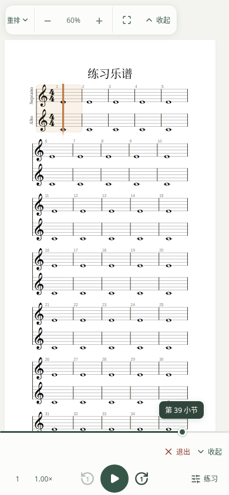
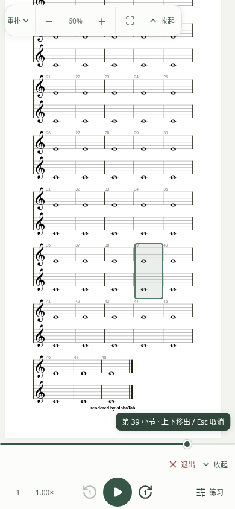
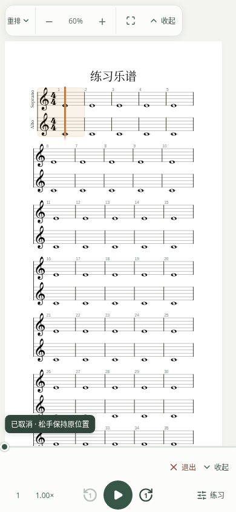

# XML 进度拖动、预览与自动跟随

基线：`086335e`（2026-11-16 获取的最新 main）。不修改 XML、混音偏好、循环范围或持久数据。

## 交互选择

原进度条在拖动时只显示目标小节文字，指针在条外松开仍提交；Escape／失焦虽清空草稿，原手势后续的原生 `input` 事件却可能直接寻址。片段循环已有暂停试听、滚动定位、整小节高亮与取消恢复机制，本次直接复用。

调研参考 [W3C Pointer Cancellation](https://www.w3.org/WAI/WCAG22/Understanding/pointer-cancellation.html)：按下后可在松开前中止，典型方式包括移出目标区域或明确取消。[Apple iMovie 的 scrub 交互](https://support.apple.com/en-mide/guide/imovie-iphone/knaeca4b0ea2/ios)也让拖动位置与可见内容同步，适合作为谱面定位的参照。

[W3C Dragging Movements](https://www.w3.org/WAI/WCAG22/Understanding/dragging-movements.html)强调保留不依赖拖动的单指针操作，因此继续保留「定位小节」弹层与前后小节按钮。

比较了严格离开滑块即取消、额外取消按钮、垂直移出后取消。严格边界容易误触；额外按钮需要在单指按住时另作操作。因此保留水平拖动和原生 range 的键盘／辅助技术行为，**从按下位置垂直移出超过 72 CSS px，即取消本次手势**。72px 是本产品为手指抖动保留余量的选择，并非平台标准。拖动气泡显示「上下移出 / Esc 取消」，取消后显示「已取消 · 松手保持原位置」。取消是本次手势的最终状态，移回、继续拖动和松手均不会重新确认；重新按下可以开始新手势。

## 最终行为

- 拖动／键盘调节预览目标整小节，高亮随目标更新，谱面滚到目标；预览期间暂停，尚不发送目标寻址。
- 松手确认只寻址一次，沿用循环边界、反复经过、播放／暂停和预备拍规则；不会先恢复旧播放位置再跳转。
- 垂直移出、Escape、系统 pointercancel、窗口失焦或控件卸载结束预览。预览定位考虑临时查看放大比例；取消恢复原播放状态、原查看比例、横纵浏览位置和原跟随状态；原手势的剩余事件不能寻址。
- 从原始 PDF 拖动时临时显示重排谱面；取消恢复 PDF，确认保留目标谱面。对照视图不切换。
- 自动跟随关闭后，点击有效谱面小节先按原有规则跳转，再在目标位置恢复跟随；临时放大查看时按「恢复自动跟随」的规则回到适合宽度，保留重排字号。点空白和滚动不触发这一行为。

## 真实截图与动态说明

均为同一 48 小节双声部测试谱、390 × 844 Chromium 浏览器截图。修改前使用原始 main 构建，修改后使用本分支构建；没有拼接或修饰页面内容。

| 原版：拖到第 39 小节，谱面仍在开头 | 修改后：滚到并高亮第 39 小节 |
| --- | --- |
|  |  |

截图无法证明松手是否提交。浏览器验证实际执行「按住 → 横移到目标 → 上移 100px → 移回进度条 → 松手」，并检查播放进度仍为原值、谱面滚动位置恢复、引擎 `alphaSynth.setTickPosition` 命令数组为空。另执行正常确认，检查仅有一次目标寻址；播放中确认与取消均继续播放。这样同时验证界面和实际引擎动作。

## 验证范围

生产构建（含类型与预缓存检查）、ESLint 通过；播放器 383 项、相关客户端 24 项、浏览器分组／选择 12 项通过。Chromium／WebKit 的进度拖动、片段循环、预备拍、播放器界面共 8 项通过；补齐放大查看后重新验证拖动与循环 4 项。保留一个浏览器回归入口 `browser-tests/playback-scrub.test.mjs`，补充原有 timeline／session 测试，复用片段循环、节拍预备和播放器界面回归。浏览器截图在 `artifacts/verification/xml-scrub/` 生成，本页只保留三张对照证据。

触摸拖动通过 Chromium CDP 原生触摸输入验证；WebKit 验证鼠标、键盘、原生 range 失焦行为及视图恢复。未做 iOS／Android 真机手势、实际听感验收，不把触摸模拟等同于真机体验。未合并、未部署。
